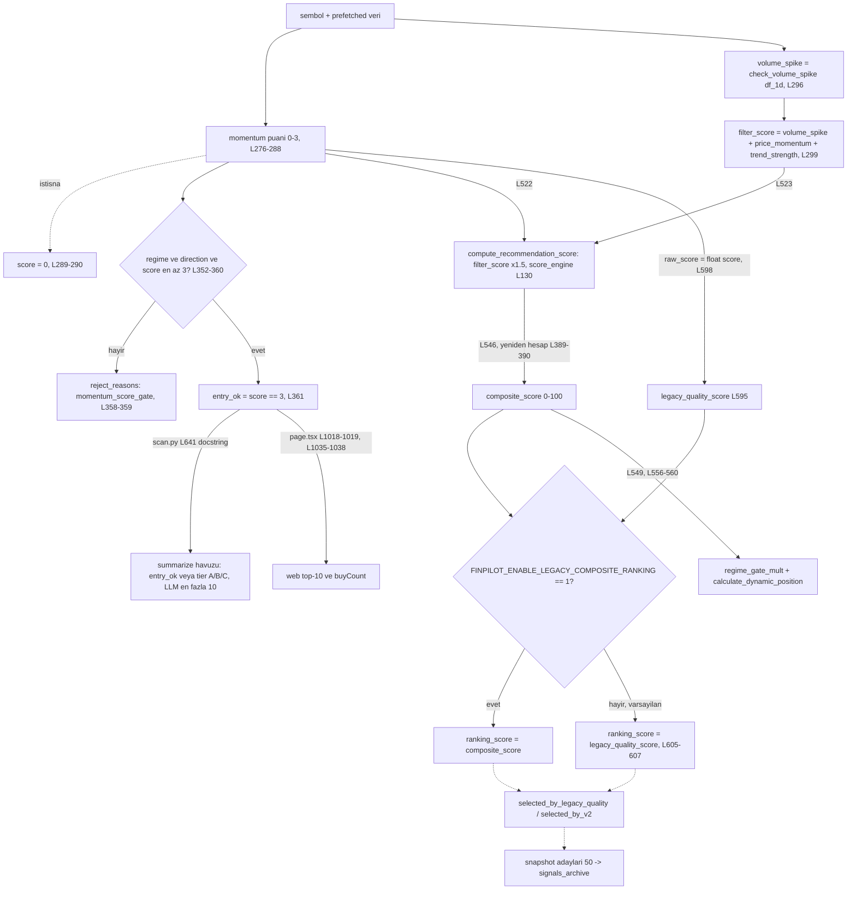
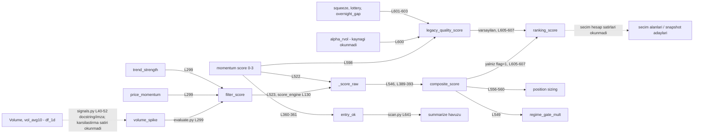

# R2 - Mimari Harita: tarayici uctan uca akis haritasi (WP-1)

| Alan | Deger |
|---|---|
| Baslik | Scanner Intelligence Audit v1 - R2 Software Architecture: uctan uca akis haritasi (WP-1) |
| Surum | v1 |
| Tarih | 2026-10-19 |
| Durum | DRAFT - Level A arastirma ciktisi; karar degildir |
| HEAD | 93ae83c (93ae83c0c6056593fde65c97358824207c97ec6d), branch review/pending-2026-10-07; calisma agaci kirli (kullanici/diger ajan isi; dokunulmadi) |
| Rol | Software Architecture (PREFIX: ARC) |
| Kapsam | Ana uretim yolu: web/src/app/dashboard/scanner/page.tsx -> web/src/app/py-api/[...path]/route.ts -> api/routers/scan.py -> scanner/evaluate.py -> scanner/data_fetcher.py -> scanner/features.py -> scanner/score_engine.py -> kalicilik (shortlist, shadow ledger, watchlist, distribution export) -> signals_archive -> core/scheduler.py resolve -> distribution/jobs.py + distribution/scan_contract.py; alternatif yollar (agents/scanner_agent.py, core/scheduler.py run_cycle_once, scanner.py, research/*); gozlemlenebilirlik bosluklari |
| Girdiler | Calisma agacindaki kod (satir numaralari calisma agacina aittir), data/finpilot.db sema meta verisi (salt-okunur: mode=ro + PRAGMA query_only=ON), data/ altindaki shortlist dosya adlari/meta verisi, orkestrator flag gozlemi 2026-10-16T13:58Z (yalniz gozlem; bu rolde dogrulanmadi) |
| Yazilan yollar | Yalniz bu dosya, scripts/ARC_*.py, data/ARC_*.(csv,json) |

## Ozet

- Ana uretim yolu (web batch -> proxy -> `/scan` -> `evaluate_symbols_parallel` -> `evaluate_symbol` -> `score_engine` -> `_complete_scan` kaliciligi -> tarayicida birlestirme -> `/scan/summarize` -> distribution snapshot -> `signals_archive` -> haftalik resolve) kod duzeyinde 12+ asamada haritalandi (bolum 1, SUPPORTED).
- P0: ARC-02 (iki API yurutme yolu; 504 sonrasi kalicilik yola bagli, uretimde aktif yol UNRESOLVED - `FINPILOT_SCAN_COORDINATOR` varsayilani '0', gozlemlenmedi), ARC-11 (sessiz bozulma: prefetch zaman asimi, dusurulen semboller, hata -> 0), ARC-10 (kapsam disi guvenlik gozlemi: `/scan/daily-report` `date` alani dosya yoluna dogrulamasiz giriyor).
- P1: ARC-01 (shortlist adi dakika cozunurlugunde, uzerine yazma). 2026-10-16 15:20 UTC gozlemi `shortlist_20261016_1820.csv` (~12 satir) dosyasidir; o turda bir 200'luk batch dosyasi eksik ve desen uzerine yazma ile tutarli (SUPPORTED). ARC-04 (batch eksikleri MEASURED, neden HYPOTHESIS), ARC-06 (tam export tarayicida birlesir), ARC-07 (arsiv secim-sonrasi, <=50 aday), ARC-08 (run kimligi yok), ARC-09 (ayni alan adlari farkli anlam).
- P2: ARC-03 (uc zaman tabani; ad saati = mtime UTC + 3 saat, 21/21 dosya MEASURED), ARC-12 (varsayilan flag'lerle `ranking_score` = `legacy_quality_score(raw_score = 0-3 momentum puani)`; `volume_spike -> filter_score -> composite_score` zinciri siralamaya yalniz `FINPILOT_ENABLE_LEGACY_COMPOSITE_RANKING=1` iken girer).
- P3: ARC-05 (proxy zaman asimi 502 + log yok).
- Gozlemlenebilirlik: tarama sonrasi run kimligi, per-scan flag seti, girdi veri anlik goruntusu ve tam rank listesi arsivden yeniden kurulamaz (bolum 4 ozet tablosu).
- Hicbir sonuc/getiri hesabi yapilmadi; hicbir bulgu OOS olarak etiketlenmedi (D7).

<!-- ANCHOR:OZET -->

## Kapsam ve yontem

- Yontem 1: `scripts/ARC_map.py` (salt-okunur) ile AST cozumlemesi (fonksiyon satir araliklari, fonksiyon ici cagri listeleri, `FINPILOT_*` flag okumalari) ve regex grep. Repo modulleri import edilmedi (`api.main` dahil); yalniz `ast` + dosya okuma.
- Yontem 2: `ARC_map.py show "<yol>:<bas>-<son>"` ile secili satir araliklari dogrudan diskten okundu (read_file onbellek bayatligi riskine karsi; bkz. repo hafiza notu PRIOR).
- Yontem 3: `data/finpilot.db` yalniz sema + satir sayisi meta verisi (`mode=ro` + `PRAGMA query_only=ON`); hicbir sonuc/getiri hesabi yok, hicbir partition uzerinde.
- Yontem 4: `data/` altindaki `shortlist_*.csv` dosyalari icin yalniz ad/mtime/boyut/satir sayisi/SHA-256 meta verisi.
- Satir numaralari calisma agacina aittir (HEAD 93ae83c + kirli degisiklikler). Kod SHA-256 on-ekleri (ilk 16 hex) `ARC_map.py funcs/greps` ciktisindadir; ornek: `api/routers/scan.py` 85cbd839913ee774, `scanner/evaluate.py` 0eb9446d8a7a9509, `scanner/score_engine.py` 9455d5205eb47626, `core/scheduler.py` 82a2590fc9f436dd, `web/src/app/dashboard/scanner/page.tsx` f32283b732c73bec, `web/src/app/py-api/[...path]/route.ts` ab739cf6526a047b.
- Etiket politikasi: kod okumasiyla dogrulanan yapisal iddialar en fazla SUPPORTED'dir (kod varligi uretim davranisinin MEASURED kaniti degildir). Disk meta verisiyle olculenler MEASURED. PRIOR = onceki artefakt/hafiza notu; bu rolde yeniden olculmedi.
- Kapsam disi: getiri/sonuc hesabi, ag/provider/HTTP cagrisi, docker, tarayici calistirma, uretim degisikligi, diger rollerin dosyalari.
- Turetilmis dosyalar: `data/ARC_function_map.csv` (257 satir; tum hedef dosyalarin fonksiyon/sinif araliklari).

<!-- ANCHOR:YONTEM -->

## Bulgular

### 1. Asama tablosu (ana uretim yolu)

Tablo kod okumasina dayanir (etiket: SUPPORTED; uretim davranisi olcumu degildir).

| # | Asama | Fonksiyon (file:lines) | Girdiler | Ciktilar | Eksik girdi davranisi | Hata davranisi | Yeniden hesap / sessiz mutasyon riski |
|---|---|---|---|---|---|---|---|
| 1 | Web batch orkestrasyonu | `web/src/app/dashboard/scanner/page.tsx`: `BATCH_SIZE = 200` (L558), `FULL_UNIVERSE_SIZE = 1812` (L559), `CONCURRENT_BATCHES = 1` (L562), batch dongusu L969-977 (`Promise.allSettled`), `apiFetch("/api/v1/scan")` L567 | Kullanici sembol listesi | Sembol bazli sonuclarin UI state birlesimi | (asagida satir 1b) | (asagida satir 1b) | Universe boyutu web'de sabit 1812, API/distribution tarafinda env `FINPILOT_FULL_UNIVERSE_SIZE` varsayilani 1812 (`distribution/scan_contract.py:expected_universe:10-11`) - iki ayri kaynak, senkron tutulmasi manuel |
| 2 | Proxy | `web/src/app/py-api/[...path]/route.ts`: `isScan` L55, `timeoutMs = isScan ? 620_000 : 20_000` L56, `node:http` istegi `timeout: timeoutMs` L66 (soket bosta-kalma zaman asimi), `on("timeout")` L108 | `/py-api/<path>` istegi | Upstream durum kodu ve govde (L90) | - | Bosta-kalma zaman asimi L108-114 dalinda; tam donus kodu bu rolde okunmadi | Govde yalniz tarama bitince gonderildigi icin (PRIOR repo notu) bosta-kalma = toplam sure; 620 s > API 600 s, normalde API 504'u once doner |
| 3 | API endpoint + yurutme | `api/routers/scan.py:run_scan:323-370` -> `scan_coordinator.enabled()` ise `_run_coordinated_scan:373-449` (`submit_scan(key, lambda: _scan_job(req))` L391-396, `wait_for(asyncio.shield(future), deadline)` L413-415, deadline = 600 s L385), aksi halde `_run_scan:461-513` (`wait_for(loop.run_in_executor(_executor, evaluate_symbols_parallel), timeout=600)` L488-499; `_executor = ThreadPoolExecutor(max_workers=16)` L43; `_SCAN_TIMEOUT_SECONDS = 600` L38) | `ScanRequest` (symbols, kelly_fraction), auth | `_complete_scan` ciktisi (sembol -> dict) | Bos sembol listesi kontrolu bu araliklarda gorulmedi | Koordineli: 504 (TimeoutError) L421-424, 503 ScanBusy L425-427, 499 ScanCancelled L428-431, 500 diger L435-438. Klasik: 504 L500-506, 500 L507-511 | Klasik yolda zaman asiminda executor thread'i durmaz (Python `run_in_executor` semantigi), sonuc atilir, `_complete_scan` calismaz; koordineli yolda is `shield` ile devam eder ve kalicilik `_scan_job:452-458` icinde HTTP yanitindan bagimsiz kosar. Klasik yolda `_complete_scan` (senkron) dogrudan event-loop coroutine'inde cagrilir (L513) |
| 3a | Sayac sifirlama | `api/routers/scan.py:_run_scan:479-481` `reset_yf_fetch_count()` | - | Process-global yfinance sayaci | - | Hata yutulur (L482-483) | Process-global sayac her batch'te sifirlanir; es zamanli taramalarda sayaclar karisabilir (HYPOTHESIS) |
| 4 | Shortlist kaliciligi | `api/routers/scan.py:_persist_shortlist:139-150` | `out` (sembol -> dict) | `_SHORTLIST_DIR/shortlist_{datetime.now():%Y%m%d_%H%M}.csv` (L145-147) | `out` bossa donus (L141-142) | Istisna loglanir, yutulur (L149-150) | Ayni dakikada biten iki batch ayni dosya adini uretir ve `to_csv` uzerine yazar (bkz. ARC-01) |

| 1b | Web batch sonucu birlestirme | `page.tsx:runScan` L949-1066: batch listesi L968-971, sirali dongu L974-995 (`CONCURRENT_BATCHES=1`), basari: `Object.assign(results, batchResult)` L981; hata: `failedBatches += 1` L988, `scanned += batch.length` L990 | Batch yanitlari | Tarayici bellegindeki `results` + `writeCache` L998 | Bos sonuc: `/py-api/health` kontrolu ve uyari L1006-1016 | Basarisiz batch atlanir, yeniden denenmez; ilerleme sayaci basarisiz sembolleri de "taranmis" sayar (L990) | Tam-universe artefakti sunucuda degil tarayicida birlestirilir (ARC-06) |
| 1c | Post-scan ozet + gunluk rapor | `page.tsx`: `symbols.length >= FULL_UNIVERSE_SIZE` ise `runPostScanSummary(results, symbols.length, failedBatches === 0)` L1030-1032 -> POST `/api/v1/scan/summarize` `{results, universe, scan_complete}` L932-935; gunluk rapor her sonuclu taramada (tam-universe sartsiz) POST `/api/v1/scan/daily-report` L1057-1066, tarih tarayicida `new Date().toISOString().slice(0, 10)` L1045 | Birlesik `results` | Sunucuda ozet + export (asagida satir 9) | Sonuc yoksa ozet/rapor yok (L1006) | Ozet hatasi toast ile gosterilir L940-943 | Top-10 listesi istemci tarafinda `apiResultToStock(r, 0)` + `sort(b.score - a.score)` ile siralanir L1035-1038 (sunucu siralamasindan ayri bir siralama yolu) |
| 2b | Proxy hata yolu | `route.ts` L108-122: zaman asiminda `upstreamReq.destroy(new Error("Proxy request timed out"))`, hata isleyicide zaman asimi loglanmaz (L113-116) ve `502 {detail: "Backend unreachable"}` doner | - | 502 | - | Zaman asimi 504 degil 502 olarak siniflanir (ARC-05) | - |
| 9 | Batch basina distribution export | `api/routers/scan.py:_persist_distribution_export:998-1148`; tam-tarama kapisi `full_scan_problems(...)` L1061; problem varsa `scan_export_{UTC tarih}_partial_{len(current_symbols)}.json` yazilir ve donulur L1067-1079; aksi halde `scan_export_{date}.json` L1080 | Batch veya istemci-birlesik sonuclar | partial / dated / latest JSON | - | - | Partial ad sonuc sayisina gore: ayni UTC gununde ayni sayida sonuc ureten batch'ler (or. 200) ayni dosyanin uzerine yazar (PRIOR repo notu ile tutarli; kodla SUPPORTED) |

| 5 | Batch tamamlama: zenginlestirme + telemetri + kalicilik | `api/routers/scan.py:_complete_scan:516-621`: `_load_drl_cache()` + `_enrich_results(results, drl_cache, drl_valid)` L519-520; process-global sayaclar (yf, alpaca, intraday, stage timing) L522-570; `scan_coordinator.check_cancelled()` L600; sira: `_persist_shortlist` L602 -> `_persist_shadow_ledger` L603 -> `_auto_add_watchlist` L604 -> `_persist_distribution_export(out, universe=len(req.symbols), timing=_timing)` L605-609; timing log yalniz `observation is None` ise L611-614 | `evaluate_symbols_parallel` ciktisi | `out` (DRL ile zenginlesmis) + 4 kalici yan etki | Telemetri sayaclari okunamazsa -1/{}/False ile devam L526-570 | Kalicilik cagrilari `_complete_scan` duzeyinde try ile sarilmamis; bir kalicilik fonksiyonu istisna atarsa sonraki adimlar calismaz (fonksiyon icleri bu rolde tam okunmadi) | DRL zenginlestirmesi API katmaninda, `evaluate_symbol` disinda uygulanir; ayni ham sonuc farkli DRL onbellek durumlariyla farkli `out` uretebilir |
| 6 | Tam-tarama ozeti | `api/routers/scan.py:summarize_scan:635-686`: `full_scan_problems(req.results, req.universe, req.scan_complete)` -> 422 L647-652; `scan_complete is not False` ise `_persist_distribution_export(req.results, ..., scan_id=req.scan_id, scan_complete=True)` + `_trigger_distribution_draft` L657-664; LLM ozeti executor'da 180 s L666-673 | Istemci-birlesik `results`, `universe`, `scan_complete`, `scan_id` | Tam export + taslak tetigi + ozet | Kapi sartlari saglanmazsa 422 | Ozet 504/500; export ozetten once yazildigi icin ozet hatasinda da kalir | `scan_complete=None` kapidan "false degil" olarak gecer (L52, L657) |
| 7 | Gunluk rapor | `api/routers/scan.py:save_daily_report:912-921` -> `data/daily_reports/{req.date}.json`, mod `w` L915-918 | Istemci raporu (tarih istemcide) | Tarih basina tek JSON | - | - | Her sonuclu tarama (preset dahil) ayni gunun raporunun uzerine yazar |
| 10 | Tam-tarama kapisi | `distribution/scan_contract.py:full_scan_problems:46-66` | results, beyan edilen universe, scan_complete | Engel listesi | `scan_complete is False` -> tek engel L52-53 | - | Esikler env'den cagri aninda: 1812, 0.9, 0.5 (L10-21) |
| 11 | signals_archive yazici | `distribution/archive_bridge.py` L45-100: snapshot `candidates` icin `INSERT OR IGNORE INTO signals_archive (id, symbol, ts, score, finpilot_score, payload_json, resolved_status='new')` L80-92; `score = enrich.score or metrics.conviction_prob` L88; payload `{source, date, resolver_fields, **cand}` L75-79; zenginlestirme `watchlist_signals`'tan `(symbol, date)` ile L65 | Yayin snapshot'i (`MAX_CANDIDATES = 50`, `snapshot_builder.py` L34) | Aday basina 1 satir (id = symbol+tarih) | Sembolsuz aday atlanir L62-63; tarih yoksa `date.today()` (yerel) L53 | DB hatasi yukari firlatilir (docstring L49-50) | `score` kolonu iki farkli anlam tasiyabilir (watchlist skoru veya conviction_prob) |

| 3b | Paralel degerlendirme | `scanner/evaluate.py:evaluate_symbols_parallel:761-852` (`@coordinate_scan @observe_scan`); prefetch cagrisi `max_workers=10` L790-794; `_eval_workers = min(32, max(4, total))` L809; `ThreadPoolExecutor` L817; sembol basina `evaluate_symbol(symbol, kelly_fraction, prefetched_data=symbol_data)` L815; prefetch'siz yol L836-845; `emit_baseline_inputs(results, scan_basis="EOD")` L851 | symbols, kelly_fraction | Yalniz basarili sonuclarin listesi | Prefetch `TimeoutError` -> `all_data = {}` ve "partial data" ile devam L795-797 | Sembol istisnasi loglanip atilir L826-827 / L844-845; bos sonuc eklenmez L824-825; `check_cancelled` L799, L812, L820, L847 | Ic ice thread havuzlari: API `_executor` 16 -> degerlendirme <=32 -> `fetch_multi_timeframe(..., max_workers=4)` (`evaluate_symbol` L245) |
| 3c | Sembol degerlendirme + skor | `scanner/evaluate.py:evaluate_symbol:228-756`: `volume_spike = bool(check_volume_spike(df_1d))` L296; `filter_score = int(volume_spike) + int(price_momentum) + int(trend_strength)` L299; `min_score_threshold = 3` L352, `momentum_score_gate` L358-359, `core_signal`/`entry_ok` L360-361; `_score_raw = compute_recommendation_score(_score_input, ...)` L544; `_composite_score = compute_recommendation_strength(...)` L546; `_legacy_quality_score = compute_legacy_quality_score(...)` L595; `_ranking_score = _composite_score if legacy_composite_ranking_enabled() else _legacy_quality_score` L605-607; `_v2_score` L608; cikti alanlari `filter_score` L648, `composite_score` L701, `ranking_score` L705. Skor motoru: `scanner/score_engine.py:compute_recommendation_score:99-190` (`score += filter_score * 1.5` L130), `compute_recommendation_strength:378-397` | Prefetch verisi (yoksa kendi fetch'i L245) | Karar alanlari (sonuc dict) | Adim bazli `except Exception` bloklari varsayilan atar (or. L289-290 `score = 0`) | Hata ile gercek sifir ayirt edilemez (ARC-11) | `compute_recommendation_strength` dict girdide `compute_recommendation_score`'u yeniden cagirir (L389-390); flag'ler cagri aninda okunur |
| 8 | Secim / siralama (dort ayri yol) | (i) `evaluate_symbol` secim alanlari (shortlist basligi: `selection_eligible`, `selected_by_legacy_quality`, `selected_by_v2`, `ranking_method`, `ranking_score`; MEASURED, komut 3); (ii) `scanner/scan_summary.py:summarize_full_scan` (`summarize_scan` L645, L669): kural havuzu (entry_ok VEYA conviction_tier A/B/C) + LLM ile <=10 (docstring L639-643), `FINPILOT_ENABLE_SCAN_LLM_SUMMARY` varsayilan '1' (`scan_summary.py:106`); (iii) distribution snapshot `MAX_CANDIDATES = 50` (`snapshot_builder.py` L34) -> arsiv; (iv) web top-10 `sort(b.score - a.score)` (`page.tsx` L1035-1038) | Sonuclar | Secim listeleri | - | - | Ayni tarama icin dort farkli siralama/secim yuzeyi; LLM secimi deterministik olmayabilir (HYPOTHESIS; model/sicaklik okunmadi) |
| 12 | Sonuc cozumleme | `core/scheduler.py:_run_resolve_open_signals_job:192-212`: `from scripts.resolve_open_signals import run` L200, `resolve_run(horizon=5, dry_run=False)` L202, hata -> warning L212; kayit `CronTrigger(day_of_week="mon", hour=12, minute=35, timezone="Europe/Vienna")` L1303-1306 (`_make_watchdog_job` L1304) | `signals_archive` acik satirlari | `resolved_*` kolonlari (`scripts/resolve_open_signals.py` UPDATE L111) | - | Hata yutulur, warning | Docstring "Mondays 03:00 UTC" (L193) ile kayit (Pazartesi 12:35 Vienna) uyusmuyor; resolver calisma aninda `ALTER TABLE signals_archive ADD COLUMN` yapabiliyor (`resolve_open_signals.py` L64) |

<!-- ANCHOR:S1 -->

### 2. Mermaid diyagramlari

Gosterim: duz ok = kodda okunarak dogrulandi; kesikli ok = yalniz fonksiyon adi/docstring duzeyinde veya cagri yeri okunmadi.

(a) Veri akisi

```mermaid
flowchart LR
  ALP["Alpaca bulk: _prefetch_alpaca_bulk L805-932"] -.-> PRE["prefetch_symbols_multi_timeframe L1257-1396"]
  YF["yfinance: _bulk_yf_download L935-1029"] -.-> PRE
  EOD["EODHD: _bulk_eodhd_intraday L1116-1146, flag varsayilan 0"] -.-> PRE
  REP["_repair_partial_alpaca_result L1149-1254"] -.-> PRE
  PRE -.->|"evaluate.py L790-794, callee adi aralikta yok"| EVP["evaluate_symbols_parallel L761-852"]
  EVP -->|"L815"| EVS["evaluate_symbol L228-756"]
  FEAT["features.py alpha faktorleri"] -.->|"cagri yeri okunmadi"| EVS
  EVS -->|"L544-608"| SCO["score_engine: recommendation, strength, legacy_quality, v2"]
  SCO --> RES["sonuc dict: filter_score, composite_score, ranking_score, entry_ok"]
  RES -->|"scan.py L456 / L488-499"| CS["_complete_scan L516-621, DRL enrich L519-520"]
  CS -->|"L602"| SL["shortlist_YYYYMMDD_HHMM.csv, yerel saat"]
  CS -->|"L603"| SH["shadow ledger"]
  CS -->|"L604"| WL["watchlist_signals"]
  CS -->|"L605-609"| PX["scan_export_DATE_partial_N.json"]
  CS -->|"HTTP yaniti L621"| WEB["Tarayici birlestirme page.tsx L981"]
  WEB -->|"L1030-1032"| SUM["POST scan/summarize L635-686"]
  SUM -->|"L657-663"| FX["scan_export_DATE.json tam"]
  SUM -->|"L668-671"| LLM["scan_summary: kural havuzu + LLM en fazla 10"]
  FX -.->|"snapshot zinciri okunmadi"| SNAP["distribution snapshot, MAX_CANDIDATES 50"]
  SNAP -->|"archive_bridge L60-92"| ARCH["signals_archive"]
  WL -->|"_watchlist_enrichment L65"| ARCH
  ARCH -->|"resolve_open_signals L78-87"| RSV["resolve, Pzt 12:35 Vienna"]
  RSV -.-> KAR["karne / edge raporlari"]
  WEB -->|"L1057"| DR["daily_reports/DATE.json"]
```

(b) Karar akisi (`evaluate_symbol` ve sonrasi)

(c) Karar degiskenleri bagimlilik grafigi

#### ARC-12 - Varsayilan flag'lerle `volume_spike -> filter_score -> composite_score` zinciri `ranking_score`'a girmiyor

- Priority: P2
- file:function:lines: `scanner/evaluate.py:evaluate_symbol` L276-290 (`score` yalniz burada atanir), L296, L299, L522-523, L544-548, L595-599 (`raw_score=float(score)`), L605-607; `scanner/score_engine.py:legacy_composite_ranking_enabled:238-240` (varsayilan '0'), `compute_recommendation_strength:378-397`.
- Data source: kod.
- Method/command: komut 6, 7, 9, 10, 11 (`score` atamalari: yalniz L276, L282, L284, L288, L290).
- Result: Orkestrator gozleminde `FINPILOT_ENABLE_LEGACY_COMPOSITE_RANKING` unset -> `ranking_score = legacy_quality_score`, bu da 0-3 momentum puani + regime/direction/ATR/rvol/faktorlerden beslenir. `volume_spike`/`filter_score` yalniz `compute_recommendation_score` (x1.5) -> `composite_score` uzerinden pozisyon boyutlandirma (L556-560) ve `regime_gate_mult` (L549) ile karar yuzeyine dokunur. Ayni skor `compute_recommendation_score` ile bir kez (L544), `score_component_breakdown` (L545) ve `compute_recommendation_strength` icinde (L389-390) tekrar hesaplanir.
- n: 1 fonksiyon, 1 flag.
- Label: SUPPORTED (kod); uretim flag degeri 2026-10-16 gozlemine dayanir (bu rolde dogrulanmadi).
- Limitations: `compute_legacy_quality_score` govdesi (L205-222) ve secim alanlarinin hesaplandigi satirlar okunmadi; `rvol` girdisi hacimle iliskili ayri bir kanal olabilir.
- Alternative explanations: Bilincli tasarim (legacy kalite skoru uretim siralamasi; composite yalniz telemetri/boyutlandirma).
- Next step: Skor denetimi rolu `filter_score`'un siralama uzerindeki marjinal etkisini flag=0/1 icin offline replay ile (OOS iddiasi olmadan) karsilastirabilir.
- Suggested category: RESEARCH_NEXT

<!-- ANCHOR:S2 -->

### 3. Alternatif yollar ve sapma

| Yol | Giris noktasi (file:lines) | Karar alanlarini ureten fonksiyon | Sonradan eklenen/degisen alanlar | Kalicilik | Sapma |
|---|---|---|---|---|---|
| A. Web -> API `/scan` | `api/routers/scan.py:run_scan:323-370` | `evaluate_symbols_parallel` -> `evaluate_symbol` | DRL overlay `_enrich_results:86-136` (L520) | shortlist, shadow ledger, watchlist, partial export (L602-609) | Referans yol |
| B. `ScannerAgent` | `agents/scanner_agent.py:ScannerAgent._run:72-124` (`evaluate_symbols_parallel` L77-85) | Ayni | `_load_drl_cache()` L96 + `scanner.finpilot_score.compute_finpilot_score` L99 | Okunan aralikta yok | `finpilot_score` API'dekinden farkli bir fonksiyonla uretiliyor; esdegerlik dogrulanmadi (UNRESOLVED) |
| C. Scheduler `run_cycle_once` | `core/scheduler.py:run_cycle_once:469-1117`; `_scheduled_job` L1156-1160; `BackgroundScheduler(timezone="UTC", coalesce, max_instances=1)` L1151-1154; autostart varsayilani '1' (`api/main.py:190`) | `core/scheduler.py` icinde `evaluate_symbols_parallel` cagrisi yok (komut 1 global grep) | `score_val = win_rate` (L706), `"finpilot_score": bt_sym.get("win_rate", 0)` (L963), legacy alarm `"score": int(finpilot_score)`, `"filter_score": 3` (L1032-1033) | `kpi_tracker.record_signal` (L501, L725), Telegram (L1037) | Ayni alan adlari farkli anlam tasiyor (ARC-09) |
| D. Dogrudan uretim cagrisi yapan betikler | `scripts/golden_scan.py` L163-178, `scripts/run_scanner_performance_benchmark.py` L80-95, `research/scanner_perf_baseline_2026_10_17.py` L41-50, `research/gate_b1_live_instrumentation_2026_09_09.py` L51-64, `research/gate_b2_manual_accumulation_2026_09_09.py` L59-86; `scripts/run_scanner_replay_scaling.py` L151 (`evaluate_symbol`) | Ayni uretim fonksiyonu | DRL overlay ve API kaliciligi yok | Betige ozgu | Karar alanlari ayni fonksiyondan; overlay/kalicilik farkli |
| E. Arastirma yeniden skorlama | `research/score_bridge.py` L7 (uretim `compute_recommendation_score`, `score_component_breakdown` import); `research/flag_impact_measurement_2026_09_10.py` L101; `research/instrumentation_validation_2026_09_09.py` L18; `research/score_replay.py:_score_flags:39-54` (`os.environ` gecici degistirme) | Uretim skor fonksiyonlari | Flag'ler surec ortaminda gecici degistirilir | Arastirma ciktilari | Process-global env mutasyonu es zamanli kullanimda thread-guvenli degil (HYPOTHESIS) |
| F. Yeniden uygulamalar | `research/b2_0_independent_verification_2026_09_23.py` `rec_score` L258-287, `composite` L290-291; `scripts/component_ablation.py` `composite` L76; `backtest_full_universe.py` `filt_composite` L181 | Kendi formulleri | - | - | Uretim formulunden sapabilir; uretimle esitlik testi bu rolde gorulmedi |
| G. Legacy | Kok `scanner.py` YOK (komut 1: `MISSING scanner.py`) - `from scanner import evaluate_symbols_parallel` `scanner/` paketine cozulur; repo kodunda `*_legacy*` adli dosya yok (yalniz `.venv-contract/` altinda 3 ucuncu taraf dosya); `archive/` 57 .py, 2 .db, 6 .html, 5 .md (komut 3); `data/finpilot.db` icinde `scan_results`, `signals`, `buy_signals`, `signal_events`, `outcomes_horizon` 0 satir | - | - | - | Ana yol bunlari kullanmiyor gibi gorunuyor (tam import taramasi yapilmadi) |

#### ARC-09 - Ayni karar alani adlari yollar arasinda farkli anlam tasiyor (`score`, `finpilot_score`, `filter_score`)

- Priority: P1
- file:function:lines: `core/scheduler.py:run_cycle_once:469-1117` (L706, L725, L963, L1032-1033, L1009); karsilastirma: `scanner/evaluate.py` L299/L648 (`filter_score` 0-3 hesaplanan), `agents/scanner_agent.py` L99 (`compute_finpilot_score`), `distribution/archive_bridge.py` L88 (`score` = watchlist skoru veya `conviction_prob`).
- Data source: kod.
- Method/command: komut 1 (grep) + komut 7.
- Result: Scheduler dongusunde `finpilot_score` backtest `win_rate`'tir (L963), KPI kaydina `score=round(win_rate*100, 1)` yazilir (L706-725), legacy alarmda `filter_score` sabit 3'tur (L1033; varsayilan kapali flag `FINPILOT_ENABLE_LEGACY_SIGNAL_ALERTS` L1009 arkasinda). API yolunda ayni adlar tarayici hesaplarini tasir. KPI/self-evaluate ciktilari tarayici skoruyla ayni sey olarak okunursa yanlis yorumlanir.
- n: 3 alan, 4 yol.
- Label: SUPPORTED (kod); scheduler dongusunun uretimde calisip calismadigi UNRESOLVED (`_scheduled_job`'in hangi kosulda kaydedildigi L1167 sonrasi tam okunmadi; `FINPILOT_SCHEDULER_LEGACY_JOBS` varsayilani '0').
- Limitations: `run_cycle_once` 649 satir; yalniz grep satirlari ve L1000-1040 okundu.
- Alternative explanations: Scheduler dongusu ayri bir "agent" urunu olarak tasarlanmis olabilir; isim cakismasi tarihsel.
- Next step: `kpi_tracker` tuketicilerini ve dongunun uretimde kayitli olup olmadigini (`scheduler_status`) salt-okunur olarak dogrula.
- Suggested category: RESEARCH_NEXT

<!-- ANCHOR:S3 -->

### 4. Gozlemlenebilirlik bosluklari

#### ARC-01 - Shortlist dosya adi dakika cozunurlugunde; ayni dakikada biten batch'ler birbirinin uzerine yazar

- Priority: P1 (ekonomik degerlendirme / yeniden kurulum engeli)
- file:function:lines: `api/routers/scan.py:_persist_shortlist:139-150` (ad L145-146, yazim L147); tuketiciler `shortlist_status:732-753` (L735) ve `get_shortlist_latest:825-875` (L832) `sorted(glob("shortlist_*.csv"))` ile sozluk sirasina gore son dosyayi alir.
- Data source: kod (calisma agaci; `scan.py` sha256 on-eki 85cbd839913ee774).
- Method/command: `ARC_map.py show "api/routers/scan.py:139-150"`.
- Result: Ad `shortlist_%Y%m%d_%H%M.csv`, zaman `datetime.now()` (naive, konteyner yerel saat dilimi), yazim `pd.DataFrame(...).to_csv(csv_path, index=False)` (pandas varsayilan mod `w`). Kilit, saniye, run id veya batch eki yok. Web 200'luk sirali batch'ler gonderdigi icin (satir 1) ayni dakikada biten iki batch'in ikincisi ilkini sessizce siler; ayrica "latest shortlist" tam taramayi degil tek bir batch'i (<=200 satir) temsil eder.
- n: 1 fonksiyon, 2 API tuketicisi.
- Label: SUPPORTED (kod). 2026-10-16 15:20 UTC gozlemi icin disk meta verisi asagida (ARC-01 ek).
- Limitations: Uretim konteyner loglari ("Shortlist saved" satirlari) bu rolde okunamaz (docker yasak). Konteyner saat dilimi dogrulanmadi.
- Alternative explanations: Dosya dakika icinde tek batch tarafindan yazilmis olabilir; yalniz dosya sayisi < batch sayisi oldugunda uzerine yazma ile eksik batch ayirt edilemez.
- Next step: Ayni gun icin `shortlist_*` dosya sayisini batch sayisi (ceil(1812/200)=10) ve `scan_export_*_partial_*` dosyalariyla karsilastir; API loglarinda ayni dakikaya dusen birden fazla "Shortlist saved" satiri ara (log erisimi olan rol).
- Suggested category: FIX_CANDIDATE

#### ARC-02 - Iki ayri API yurutme yolu: zaman asimi sonrasi kalicilik davranisi yola gore farkli

- Priority: P0 (gecerlilik: istemcinin 504 aldigi bir batch'in arsive girip girmedigi yola baglidir)
- file:function:lines: `api/routers/scan.py:run_scan:323-370` (dal L329-332), `_run_coordinated_scan:373-449`, `_scan_job:452-458`, `_run_scan:461-513`.
- Data source: kod.
- Method/command: `ARC_map.py show "api/routers/scan.py:323-513"`.
- Result: (a) Koordineli yol: `evaluate_symbols_parallel` + `_complete_scan` (zenginlestirme + tum kalicilik) ayni is fonksiyonunda (`_scan_job`) kosar; HTTP tarafi `asyncio.shield` ile bekler, 600 s sonunda 504 doner ama is iptal edilmez; `finally` icinde `handle.detach()` (L446-447). Isin detach sonrasi `scan_coordinator.check_cancelled()` (L457) ile durup durmadigi `core/scan_coordinator.py` semantigine baglidir. (b) Klasik yol: 504 sonrasi thread calismaya devam eder, sonuc atilir, kalicilik yok. Yani ayni 504 yaniti bir yolda "arsivlendi ama UI'da yok", digerinde "hesaplandi ama hicbir yere yazilmadi" anlamina gelebilir.
- n: 2 yol.
- Label: SUPPORTED (kod yapisi); uretimde hangi yolun aktif oldugu: UNRESOLVED (flag okumasi asagida).
- Limitations: Calisma zamani gozlemi yok; PRIOR repo notu (2026-10-08) klasik yolda 733 s suren bir isin sonraki batch ile cakistigini kaydetmis - bu rolde yeniden olculmedi.
- Alternative explanations: Koordinator detach sonrasi isi iptal ediyorsa (a) yolunda da kalicilik olmaz; bu durumda fark yalniz kaynak tuketimindedir.
- Next step: `core/scan_coordinator.py` icinde `detach`/`check_cancelled` semantigini oku; uretim flag degerini dogrula; 504 alan batch'lerin sembollerinin `scan_export`/`signals_archive` icinde olup olmadigini meta veri ile karsilastir.
- Suggested category: RESEARCH_NEXT

#### ARC-01 ek - 2026-10-16 shortlist dosya meta verisi (MEASURED)

Kaynak: `data/shortlists/` (komut 3, `ARC_map.py files`; tam liste + SHA-256: `data/ARC_shortlist_files_20261016.json`). Toplam `shortlist_*.csv` = 2198 (tek dizin `data/shortlists`); 2026-10-16 icin 21 dosya. Satir sayisi yeni satir sayimina dayanir (yaklasik; tirnakli alan icinde satir sonu varsa sisebilir).

| Dosya adi (yerel saat) | mtime (UTC) | ~satir | SHA-256 (ilk 12) |
|---|---|---|---|
| shortlist_20261016_1512 | 12:12:35 | 199 | 28c0a19d548c |
| shortlist_20261016_1514 | 12:14:43 | 200 | fa6bde44cec7 |
| shortlist_20261016_1522 | 12:22:09 | 200 | 0e8286e42550 |
| shortlist_20261016_1527 | 12:27:31 | 198 | 20a08cbd273f |
| shortlist_20261016_1532 | 12:32:14 | 200 | a6a82ab2bd94 |
| shortlist_20261016_1547 | 12:47:53 | 198 | 4052bef87192 |
| shortlist_20261016_1605 | 13:05:44 | 200 | 515c8647849c |
| shortlist_20261016_1606 | 13:06:11 | 12 | 51df37391d1c |
| shortlist_20261016_1630 / 1632 / 1719 | 13:30:02 / 13:32:40 / 14:19:32 | 1 / 1 / 1 | a3c01c23b7a7 / 46bfad0ae966 / 4f1563820110 |
| shortlist_20261016_1721 | 14:21:40 | 30 | da5767338a58 |
| shortlist_20261016_1722 | 14:22:36 | 199 | ce7333bd6049 |
| shortlist_20261016_1728 | 14:28:44 | 200 | fd3918aac979 |
| shortlist_20261016_1736 | 14:36:09 | 200 | 3cc9b53d60dc |
| shortlist_20261016_1743 | 14:43:48 | 198 | 93b9908e5535 |
| shortlist_20261016_1750 | 14:50:09 | 200 | 7ff3a704a07a |
| shortlist_20261016_1756 | 14:56:56 | 194 | b04e2695226b |
| shortlist_20261016_1805 | 15:05:56 | 198 | d7af6b1c56ae |
| shortlist_20261016_1813 | 15:13:26 | 200 | 9a706891df54 |
| shortlist_20261016_1820 | 15:20:30 | 12 | e43dbba0033a |

- 15:20 UTC gozlemi `shortlist_20261016_1820.csv` dosyasina karsilik gelir (ad yerel saatle 18:20). Dosyada ~12 satir var; 1812 = 9x200 + 12 oldugundan bu, tam taramanin son (12 sembollu) batch'i ile tutarli.
- 14:22-15:20 UTC araliginda ~200 satirlik 8 dosya + 12 satirlik 1 dosya var; tam tarama 9 adet 200'luk batch gerektirir -> bir 200'luk batch dosyasi eksik (MEASURED sayim). 1813 -> 1820 arasi 7 dk; ayni gunun ilk turunda 12 sembollu son batch 1 dk surmus (1605 -> 1606). Bu desen, eksik 200'luk batch'in 18:20 dakikasinda bitip 12 sembollu batch tarafindan uzerine yazilmasiyla tutarlidir. Etiket: SUPPORTED (kod mekanizmasi + meta veri deseni); uzerine yazilan icerik artik diskte olmadigindan dogrudan olculemez.
- 12:12-13:06 UTC turunda ~200 satirlik 7 dosya + 12 satirlik 1 dosya var (2 adet 200'luk batch eksik); 1532 -> 1547 (15 dk) ve 1547 -> 1605 (18 dk) bosluklari, 600 s zaman asimina ugrayip kalicilik uretmeyen batch'lerle tutarli (HYPOTHESIS; ARC-02/ARC-04).

#### ARC-03 - Ayni hatta uc farkli zaman tabani: shortlist adi yerel UTC+3, export/run_id UTC, scheduler Europe/Vienna

- Priority: P2
- file:function:lines: `api/routers/scan.py:_persist_shortlist:145` (`datetime.now()`, naive); `_persist_distribution_export:998-1148` icinde `datetime.now(tz=UTC)` L1035 (date) ve L1039 (`run_id` `%Y%m%dT%H%M%S`); `_append_scan_timing_log` L975 (UTC date); `core/scheduler.py:start_scheduler` cron tetikleyicileri `timezone="Europe/Vienna"` (or. L1210, L1305) ve bir adet `timezone="UTC"` (L1366).
- Data source: kod + `data/shortlists/shortlist_20261016_*.csv` mtime meta verisi (21 dosya).
- Method/command: komut 1 (greps) ve komut 3 (files).
- Result: 21/21 dosyada ad saati = mtime(UTC) + 3 saat (or. 1512 <-> 12:12:35Z, 1820 <-> 15:20:30Z). Shortlist adlari konteyner yerel saatinde (UTC+3), distribution export tarih/run_id UTC'de, zamanlanmis isler Europe/Vienna'da. UTC 21:00-24:00 arasinda biten bir batch'in shortlist adi bir sonraki takvim gununu tasir; export ise ayni UTC gununu.
- n: 21 dosya; 3 zaman tabani.
- Label: MEASURED (ofset, 21 dosya) + SUPPORTED (kod).
- Limitations: Konteyner TZ ayari dogrudan okunmadi (env/compose degerleri okunmadi); ofset yalniz 2026-10-16 dosyalarinda olculdu.
- Alternative explanations: Dosyalar konteyner disinda UTC+3 saatli bir host surecince yazilmis olabilir; sonuc (ad saati != UTC) degismez.
- Next step: Shortlist, export ve archive kayitlarini birlestiren her arastirma betiginin hangi zaman tabanini varsaydigini dogrula.
- Suggested category: FIX_CANDIDATE

#### ARC-04 - 2026-10-16 tam taramalarinda batch kaliciligi eksik; neden ayristirilamiyor

- Priority: P1
- file:function:lines: `api/routers/scan.py:_run_scan:461-513` (zaman asiminda kalicilik yok), `_persist_shortlist:139-150`; web dongusu `page.tsx` L969-977.
- Data source: `data/shortlists/shortlist_20261016_*.csv` meta verisi (yukaridaki tablo).
- Method/command: komut 3.
- Result: Iki tam-tarama gorunumlu turda beklenen 10 batch dosyasina karsi 8 ve 9 dosya var (MEASURED). Eksiklerin nedeni (zaman asimi -> klasik yolda kalicilik yok; ayni dakika uzerine yazma; istemci hatasi) shortlist dosyalarindan ayristirilamaz.
- n: 2 tur, 17 batch dosyasi (1/1/1/30 satirlik 4 dosya ayri istek olarak disarida birakildi).
- Label: MEASURED (sayim) / HYPOTHESIS (neden).
- Limitations: Tur sinirlari zaman damgasindan cikarildi; hangi isteklerin ayni web oturumuna ait oldugu kaydedilmiyor (run id yok, bkz. bolum 4).
- Alternative explanations: 1512 ve 1514 dosyalari (2 dk ara) farkli istemcilerden gelmis olabilir; tur ici batch sayisi bu durumda farklidir.
- Next step: Ayni gun icin `scan_export_2026-10-16*` partial/degraded dosya adlarini ve `scan_timing` log kayitlarini (varsa) meta veri duzeyinde eslestir.
- Suggested category: NEEDS_MORE_DATA

#### Flag varsayilanlari (AST ile cikarildi; MEASURED kod sabitleri, uretim degeri degil)

Kaynak: komut 3 (`ARC_map.py flags`), tam liste `data/ARC_flag_reads.csv` (71 flag, 93 referans). Okumalarin tamami fonksiyon icinde (cagri aninda) yapiliyor; modul seviyesinde dondurulmus flag gorulmedi.

| Flag | Kod varsayilani | Okuma yeri | Orkestrator gozlemi 2026-10-16T13:58Z |
|---|---|---|---|
| FINPILOT_SCAN_COORDINATOR | '0' | `core/scan_coordinator.py:enabled:32` | gozlemlenmedi (listede yok) |
| FINPILOT_SCAN_OBSERVABILITY | '1' | `core/scan_observability.py:enabled:29` | gozlemlenmedi |
| FINPILOT_SCAN_MAX_CONCURRENT / QUEUE_CAPACITY / QUEUE_WAIT_S / ESTIMATED_JOB_S / DEDUPE / COOP_CANCEL | '1' / '1' / '120' / '480' / '1' / '1' | `core/scan_coordinator.py:get_coordinator:260-265` | gozlemlenmedi |
| FINPILOT_AUTOSTART_SCHEDULER | '1' | `api/main.py:lifespan:190` | unset -> varsayilan '1' |
| FINPILOT_SCHEDULER_LEGACY_JOBS | '0' | `core/scheduler.py:start_scheduler:1167` | gozlemlenmedi |
| FINPILOT_ENABLE_LEGACY_SIGNAL_ALERTS | '0' | `core/scheduler.py:run_cycle_once:1009` | unset -> '0' |
| FINPILOT_ENABLE_LEGACY_COMPOSITE_RANKING | '0' | `scanner/score_engine.py:legacy_composite_ranking_enabled:240` | unset -> '0' |
| FINPILOT_ENABLE_DISTRIBUTION | '0' | `distribution/jobs.py:distribution_enabled:49` | unset -> '0' |
| FINPILOT_ENABLE_SHADOW_SCORECARD | '0' | `distribution/jobs.py:maybe_run_shadow_scorecard_after_scan:813` | 1 |
| FINPILOT_ENABLE_SCAN_LLM_SUMMARY / SCAN_SUMMARY_ALERT | '1' / '0' | `scanner/scan_summary.py:106` / `:243` | 1 / 0 |
| FINPILOT_ENABLE_SQUEEZE_FACTOR | '0' | `scanner/score_engine.py:_squeeze_enabled:34`, `scanner/features.py:get_alpha_features:415`, `api/routers/market_data.py:229` | 1 |
| FINPILOT_ENABLE_LOTTERY_FADE | '0' | `scanner/score_engine.py:_lottery_enabled:62` | 1 |
| FINPILOT_ENABLE_EDGAR_CATALYST | '0' | `scanner/score_engine.py:_catalyst_enabled:45`, `scanner/catalyst.py:64`, `api/routers/market_data.py:240` | 1 |
| FINPILOT_ENABLE_FRED_MACRO | '0' | `scanner/score_engine.py:_macro_mult:89`, `core/macro_regime.py:50`, `api/routers/market_data.py:259` | 1 |
| FINPILOT_FULL_UNIVERSE_SIZE | '1812' | `api/routers/scan.py:_persist_distribution_export:1077`, `distribution/scan_contract.py:expected_universe:11` | gozlemlenmedi (web sabiti 1812, page.tsx L559) |
| FINPILOT_MIN_FULL_SCAN_RATIO / MIN_USABLE_SCAN_RATIO | '0.9' / '0.5' | `distribution/scan_contract.py:15` / `:20` | gozlemlenmedi |
| FINPILOT_EXECUTION_MODE | 'dry_run' | `api/routers/execution.py:52`, `:78` | dry_run |

Not: Orkestrator listesindeki FUNDAMENTALS ve NEWS flaglari icin `FINPILOT_` on-ekli sabit string okumasi AST taramasinda bulunamadi (farkli ad/sarmalayici ile okunuyor olabilir) -> UNRESOLVED. `FINPILOT_SCAN_COORDINATOR` gozlemlenmedigi icin uretimde hangi API yolunun (ARC-02) aktif oldugu UNRESOLVED; varsayilan '0' klasik yolu secer.

#### ARC-05 - Proxy zaman asimi 502 "Backend unreachable" olarak donuyor ve loglanmiyor

- Priority: P3
- file:function:lines: `web/src/app/py-api/[...path]/route.ts` L108-110 (timeout -> destroy), L112-122 (hata isleyici; `isTimeout` ise `console.error` atlanir, her durumda 502).
- Data source: kod (route.ts sha256 on-eki ab739cf6526a047b).
- Method/command: komut 4.
- Result: 620 s soket bosta-kalma asimi istemciye 502 + "Backend unreachable" olarak doner ve proxy logunda iz birakmaz; API'nin kendi 504'u ise oldugu gibi iletilir (L90). Web tarafi tum batch hatalarini tek sayacta toplar ve "muhtemelen zaman asimi" der (`page.tsx` L1000-1003). Sonradan bir batch'in API 504'u mu, proxy asimi mi, ag hatasi mi oldugu ayristirilamaz.
- n: 1 hata yolu.
- Label: SUPPORTED
- Limitations: Uretimde proxy asiminin gerceklesip gerceklesmedigi bilinmiyor (API 600 s < proxy 620 s).
- Alternative explanations: Tasarim geregi kullaniciya sade mesaj; ancak tani kaydi da yok.
- Next step: Batch hata nedenlerinin (HTTP kodu) istemci tarafinda kaydedilip kaydedilmedigini incele.
- Suggested category: FIX_CANDIDATE

#### ARC-06 - Tam-universe ciktisi tarayicida birlestirilip `/scan/summarize`'a geri gonderiliyor; `scan_complete` ve `universe` istemci beyani

- Priority: P1
- file:function:lines: `page.tsx:runScan` L981 (birlestirme), L1030-1032 (`universe = symbols.length`, `scan_complete = failedBatches === 0`), `runPostScanSummary` L925-947 (POST govdesi L935); sunucu kapisi `api/routers/scan.py:_persist_distribution_export` L1061 (`full_scan_problems(current_results, universe, scan_complete)`); esikler `distribution/scan_contract.py` L10-21 (1812, 0.9, 0.5).
- Data source: kod.
- Method/command: komut 1 + komut 4.
- Result: Sunucu, tam-tarama export'unu kendi kaydettigi batch ciktilarindan degil, istemcinin gonderdigi birlesik `results` sozlugunden uretir; tamlik bayragi ve universe boyutu istemci tarafindan beyan edilir. Batch ciktilari sunucuda yalniz partial/shortlist olarak (uzerine yazilabilir adlarla; ARC-01, satir 9) kalir; dolayisiyla sunucu tarafinda tam export'u batch kayitlariyla capraz dogrulayacak bir run kimligi yok.
- n: 1 yol.
- Label: SUPPORTED
- Limitations: `/scan/summarize` govdesinin sunucuda ek dogrulamaya tabi olup olmadigi bu rolde yalniz `full_scan_problems` duzeyinde okundu.
- Alternative explanations: Tek-kullanicili/guvenilir istemci varsayimi bilincli bir tasarim tercihi olabilir.
- Next step: Summarize govdesi ile ayni gunun batch partial export'larinin sembol kumelerini meta veri duzeyinde karsilastir.
- Suggested category: RESEARCH_NEXT

#### ARC-07 - signals_archive secim-sonrasi bir arsiv: yalniz yayinlanan snapshot adaylari, karisik anlamli `score` kolonu

- Priority: P1
- file:function:lines: `distribution/archive_bridge.py` L45-100 (yazici), `distribution/snapshot_builder.py` L34 (`MAX_CANDIDATES = 50`); sema `data/finpilot.db` `signals_archive` (id, symbol, ts, score, finpilot_score, payload_json, resolved_status, resolved_pct, resolved_pct_t5, resolved_pct_barrier, resolved_status_barrier; 5748 satir; DB sha256 b64c0c52...f5f6).
- Data source: kod + DB semasi (komut 3).
- Method/command: komut 3 + komut 5.
- Result: Arsive yalniz snapshot'in `candidates` listesi yazilir; secilmeyen universe uyeleri, sira (rank) ve secim esigi kolon olarak yok. `score` kolonu `watchlist_signals.score` yoksa `metrics.conviction_prob` ile doldurulur (L88). Semada run id / flag damgasi / veri anlik goruntusu kolonu yok; bunlar ancak `payload_json` icinde aday alanlari olarak bulunabilir (payload anahtarlari bu rolde okunmadi).
- n: 1 yazici; 5748 satir (meta veri).
- Label: SUPPORTED (kod + sema)
- Limitations: `scripts/migrate_signal_archive_to_sqlite.py` (L18, L81) ikinci bir tarihsel yazici; eski satirlarin kaynagi ayri olabilir. Yazicinin hangi job tarafindan cagrildigi bu rolde dogrulanmadi.
- Alternative explanations: Arsivin amaci yayin karnesi (`distribution/karne.py`) oldugu icin secim-sonrasi tasarim bilincli olabilir.
- Next step: Siralama/secim degerlendirmesi icin secilmeyen adaylarin kaynaginin (tam `scan_export_{date}.json`) saklanip saklanmadigini dogrula.
- Suggested category: RESEARCH_NEXT

#### ARC-08 - Run kimligi uctan uca tasinmiyor: sunucu `scan_id` destekliyor, web gondermiyor

- Priority: P1
- file:function:lines: `api/routers/scan.py:summarize_scan:661` (`scan_id=req.scan_id`); `page.tsx:runPostScanSummary` L935 (govde `{ results, universe, scan_complete }`, `scan_id` yok); `_persist_distribution_export` L1039 (`run_id` = UTC `%Y%m%dT%H%M%S`, cagri basina); `_persist_shortlist` L145 (dakika); `save_daily_report` L915 (tarih).
- Data source: kod.
- Method/command: komut 4 + komut 5.
- Result: Bir web taramasinin 10 batch'i, ozet cagrisi, shortlist dosyalari, partial export'lar, gunluk rapor ve arsiv satirlari arasinda ortak bir anahtar yok. Her artefakt kendi zaman damgasini (farkli zaman tabanlariyla, ARC-03) uretir; gunluk rapor tarih basina tek dosya ve preset taramalariyla uzerine yazilir.
- n: 6 artefakt turu.
- Label: SUPPORTED
- Limitations: `ScanSummarizeRequest.scan_id` alaninin varsayilani bu rolde okunmadi (gonderilmezse None oldugu varsayildi).
- Alternative explanations: Koordineli yolda (`FINPILOT_SCAN_COORDINATOR=1`) gozlem nesnesi bir uuid tasir (`run_scan` L335, L377) ancak bu kimlik kalici artefaktlara yazilmiyor gibi gorunuyor (HYPOTHESIS).
- Next step: Web'in tek bir tarama oturumu icin uuid uretip batch ve ozet cagrilarina eklemesinin etkisini degerlendir (Level B oneri; bu rolde degisiklik yok).
- Suggested category: FIX_CANDIDATE

#### ARC-11 - Degerlendirmede sessiz bozulma: prefetch zaman asimi, dusurulen semboller, hata -> sifir

- Priority: P0
- file:function:lines: `scanner/evaluate.py:evaluate_symbols_parallel` L795-797 (prefetch `TimeoutError` -> `all_data = {}`), L824-827 ve L840-845 (istisna -> log + sembol dusurulur); `evaluate_symbol` L289-290 (`except Exception:` -> `score = 0`), ayni `score` L352-359'da `momentum_score_gate` reddine baglanir.
- Data source: kod (`evaluate.py` sha256 on-eki 0eb9446d8a7a9509).
- Method/command: komut 1 (grep) + komut 7.
- Result: (a) Prefetch zaman asiminda tum batch prefetch'siz devam eder; sonuc kaydinda bu durumu belirten alan bu aralikta gorulmedi. (b) Istisna atan semboller yanit listesinde yer almaz; yanit, istenen sembollerden hangilerinin hata nedeniyle eksik oldugunu soylemez (web bunu "basarili batch" sayar). (c) Momentum puani hesaplamasindaki istisna puani 0 yapar ve sembol gercek bir gate reddi ile ayni gerekceyle elenir.
- n: 3 mekanizma.
- Label: SUPPORTED (kod); siklik NOT_MEASURABLE (uretim loglari bu rolde okunamaz).
- Limitations: L271-290 try blogunun tam kapsami okunmadi; `_unavailable_result` (L73-111) bazi hata durumlarini acik isaretliyor olabilir.
- Alternative explanations: Hata oranlari ihmal edilebilir duzeydeyse etki kucuk; `scan timing` logundaki sayaclar (yf/alpaca) dolayli iz birakabilir.
- Next step: Loglardaki `Evaluate error for` ve `Prefetch phase timed out` satirlarini sayan log-erisimli bir rol; sonuc kaydina hata/eksik-veri bayragi eklenip eklenmeyecegi Level B karari.
- Suggested category: FIX_CANDIDATE

#### Ozet tablo: tarama sonrasi neyin yeniden kurulabildigi

| Bilgi | Kaydediliyor mu? | Nerede (file:lines) | Not |
|---|---|---|---|
| Web tarama oturumu / run kimligi | Hayir | Sunucu `scan_id` alanini destekliyor (`scan.py` L661), web gondermiyor (`page.tsx` L935) | ARC-08 |
| Batch kimligi ve siniri | Hayir | Shortlist adi dakika (L145), partial export adi sonuc sayisi (L1068-1069), export `run_id` cagri basina saniye (L1039) | ARC-01, ARC-04 |
| Per-scan flag seti | Kismen | Yalniz distribution snapshot `config_sha()`: `FINPILOT_ENABLE*` env + git sha, snapshot olusturma aninda (`snapshot_builder.py` L38-46) | `SCAN_COORDINATOR`, `FULL_UNIVERSE_SIZE`, `MIN_*_RATIO` kapsam disi; batch/shortlist/arsiv semasinda flag kolonu yok |
| Girdi veri anlik goruntusu (barlar) | Hayir (bu rolde bulunmadi) | Yalniz batch telemetrisi: yf/alpaca sayaclari, intraday kapsam, `experiment_arm` (`scan.py` L584-599) | Sayaclar process-global (satir 3a) |
| Tam rank listesi | Kismen | Tam `scan_export_{date}.json` (istemci-birlesik, ARC-06); batch shortlist (uzerine yazilabilir) | Arsivde yok (ARC-07) |
| Batch hata nedeni | Hayir | Proxy asimi 502 + log yok (ARC-05); sembol hatalari yalniz log (ARC-11) | - |
| Gunluk rapor | Tarih basina son yazan | `save_daily_report` L915-918 | Preset taramalari tam taramanin raporunu ezebilir |

#### ARC-10 - (Kapsam disi guvenlik gozlemi) `/scan/daily-report` POST: `date` alani dogrulamasiz dosya yoluna giriyor

- Priority: P0 (butunluk; Level C sahibine iletilmeli)
- file:function:lines: `api/routers/scan.py:DailyReportRequest:901-908` (`date: str = Field(..., description="YYYY-MM-DD")`, desen yok L902); `save_daily_report:912-921` (`_REPORTS_DIR / f"{req.date}.json"` L915, `open(..., "w")` L918); router `APIRouter(tags=["scan"])` L27; `api/main.py:362` `app.include_router(scan.router, prefix="/api/v1")`.
- Data source: kod.
- Method/command: komut 7, 9, 10.
- Result: Fonksiyon imzasinda, router tanimi ve include satirinda auth bagimliligi yok (karsilastirma: `run_scan` L325 ve `summarize_scan` L637 acikca `Depends(require_auth)` kullanir). pathlib birlestirmesinde `..` bilesenleri veya mutlak yol (`Path / "/x"` tabani atar) yazimi `data/daily_reports` disina yonlendirebilir. GET `/scan/daily-report/{date}` (L949-959) ayni deseni okuma icin kullanir; yol parametresi varsayilan olarak `/` icermedigi icin risk daha dusuk (HYPOTHESIS).
- n: 1 yazma, 1 okuma endpoint'i.
- Label: SUPPORTED (kod + pathlib semantigi); istismar edilebilirlik UNRESOLVED (HTTP/calistirma yasak; uygulama seviyesi middleware ve konteyner dosya izinleri okunmadi). Test edilmedi.
- Limitations: Global middleware/dependency ile auth zorlanmasi `api/main.py` icinde okunmadi (import edilmedi, yalniz include satiri arandi).
- Alternative explanations: Uygulama seviyesinde auth middleware riski sinirlayabilir.
- Next step: Guvenlik sahibine Level C iletimi; `date` icin `YYYY-MM-DD` desen dogrulamasi ve auth bagimliligi degerlendirmesi (bu rolde degisiklik yok).
- Suggested category: FIX_CANDIDATE

<!-- ANCHOR:S4 -->

## Dogru calisan kisimlar

Kod okumasina dayanir (SUPPORTED); uretim davranisi olcumu degildir. Onerilen kategori: KEEP_AS_IS / DO_NOT_CHANGE.

- Resolver, arsiv yazicisinin `resolved_status='new'` satirlarini kapsar: `scripts/resolve_open_signals.py` L78-87 (`IS NULL`, `'new'`, `'open'`, `'watching'`, `'unresolvable'`); yazici `archive_bridge.py` L83.
- Arsiv yazimi (symbol, tarih) kimligiyle idempotent (`_candidate_id` L38, `INSERT OR IGNORE` L80-83) ve DB hatasini yutmaz (docstring L49-50).
- Tam-universe kapisi iki noktada: `/scan/summarize` 422 (`scan.py` L647-652) ve batch export'ta partial yol (L1061-1079); son batch'in gunun tam taramasi olarak yayinlanmasini engelleme amaci yorumda (L654-656).
- Proxy, undici'nin gizli 300 s basligindan kacinmak icin `node:http` ve 620 s bosta-kalma asimi kullaniyor (`route.ts` L12-24 yorum, L55-66); API 600 s'den buyuk.
- Flag okumalari fonksiyon icinde, cagri aninda (93 referans, modul seviyesinde dondurulmus deger yok; `data/ARC_flag_reads.csv`).
- Scheduler `coalesce=True, max_instances=1` ile ayni isin ust uste binmesini engelliyor (`core/scheduler.py` L1151-1154).
- `evaluate_symbols_parallel` birden fazla noktada iptal kontrolu yapiyor (L799, L812, L820, L847).
- Batch telemetrisi deney kolunu (`experiment_arm`) her kayitta acikca yaziyor (`scan.py` L556-599).
- `FINPILOT_EXECUTION_MODE` varsayilani `dry_run` (`api/routers/execution.py` L52, L78).

<!-- ANCHOR:DOGRU -->

## Cevaplanamayan sorular

1. Uretimde hangi API yolu aktif? `FINPILOT_SCAN_COORDINATOR` gozlemlenmedi (UNRESOLVED; ARC-02).
2. Koordineli yolda `handle.detach()` sonrasi is iptal ediliyor mu (`core/scan_coordinator.py` okunmadi)?
3. `archive_snapshot_candidates` (`archive_bridge.py` L43) hangi job/betik tarafindan cagriliyor? `distribution/jobs.py` icinde referans yok.
4. `signals_archive.payload_json` anahtarlari run id / flag / rank tasiyor mu? (Bu rolde icerik okunmadi.)
5. `run_cycle_once` uretimde kayitli mi; `core/pipeline.py`/ajanlar uzerinden `evaluate_symbols_parallel`'a ulasiyor mu?
6. Orkestrator listesindeki FUNDAMENTALS ve NEWS flaglarinin kod adi (FINPILOT_ sabiti olarak bulunamadi).
7. `_enrich_results` (API) ile `compute_finpilot_score` (ScannerAgent) ayni `finpilot_score`'u uretiyor mu?
8. Konteyner saat diliminin (UTC+3) kaynagi.
9. `_persist_shadow_ledger`, `_auto_add_watchlist`, `_persist_distribution_export` istisnalari tamamen yutuyor mu (except satirlari L191, L318 mevcut; export icin dogrulanmadi)?
10. Secim alanlarinin (`selected_by_*`) hesaplandigi satirlar ve LLM seciminin determinizmi.
11. Veri saglayici sirasi (Alpaca -> yfinance -> EODHD) ve onarim (`_repair_partial_alpaca_result`) cagri zinciri.

<!-- ANCHOR:CEVAPSIZ -->

## Sinirlamalar

- Yalniz statik kod okumasi + disk meta verisi; calisma zamani gozlemi, log, HTTP, docker yok. Kod varligi uretim davranisinin MEASURED kaniti degildir.
- Satir numaralari kirli calisma agacindan; atif yapilan dosyalarin HEAD'e gore degisip degismedigi tek tek `git diff` ile kontrol edilmedi.
- `data/finpilot.db` yerel kopya; `docker-compose.yml` L71 `./data:/app/data` bind mount'u nedeniyle konteyner DB'si ile ayni oldugu varsayildi. Hash anlik.
- Shortlist satir sayilari yeni satir sayimina dayanir (yaklasik).
- Butce nedeniyle okunmayanlar: `run_cycle_once` govdesinin cogu, `core/scan_coordinator.py`, `data_fetcher` fallback sirasi, `features` cagri yerleri, `scan_summary.py`, `snapshot_builder` aday secimi, `_enrich_results`.
- Hicbir partition uzerinde sonuc/getiri hesabi yapilmadi; D7 geregi hicbir sonuc OOS degildir.
- Diger rollerin dosyalari acilmadi (git status ciktisinda yalniz adlari gorundu).

<!-- ANCHOR:SINIR -->

## Ek: komutlar

Python: `C:\Users\meric\AppData\Local\Programs\Python\Python312\python.exe -B`; script yolu `reports/scanner_intelligence_audit_v1_2026-10-19/scripts/ARC_map.py` (asagida `ARC_map.py`).

1. `python -B ARC_map.py funcs greps` -> fonksiyon araliklari + desen eslesmeleri (cikti 42 KB; terminal ciktisi dosyasindan okundu); `data/ARC_function_map.csv` yazildi.

2. `python -B ARC_map.py show "api/routers/scan.py:139-150" "api/routers/scan.py:323-513"` -> endpoint, yurutme ve shortlist kaliciligi satirlari.

3. `python -B ARC_map.py flags db files` -> `data/ARC_flag_reads.csv`, `data/ARC_db_schema.json` (data/finpilot.db sha256 b64c0c5262e0d685daa1309e6293d27c208f64a6fc213b3c00e3cb896bd5f5f6, 7811072 bayt, mtime 2026-10-19T10:08:56Z, -wal/-shm yok), `data/ARC_shortlist_files_20261016.json`.

4. `python -B ARC_map.py show "web/src/app/dashboard/scanner/page.tsx:925-1066" "web/src/app/py-api/[...path]/route.ts:104-128" "api/routers/scan.py:1060-1084"`.

5. `python -B ARC_map.py show "api/routers/scan.py:516-621" "api/routers/scan.py:635-686" "api/routers/scan.py:912-921" "distribution/archive_bridge.py:45-100" "distribution/scan_contract.py:46-66" "distribution/snapshot_builder.py:34-46"`.
6. grep (VS Code arama, regex) `scanner/{evaluate,score_engine,signals}.py`: `volume_spike\s*=|filter_score|composite_score|ranking_score|compute_recommendation_score\(|compute_legacy_quality_score\(|compute_v2_score\(` -> 23 eslesme.

7. `python -B ARC_map.py show "scanner/evaluate.py:790-852" "scanner/evaluate.py:600-612" "scanner/score_engine.py:378-397" "core/scheduler.py:1150-1170" "core/scheduler.py:1000-1040" "agents/scanner_agent.py:77-110" "research/score_replay.py:39-60" "api/routers/scan.py:901-908"`.
8. grep (VS Code arama, regex) `{api/routers/scan.py,distribution/jobs.py,distribution/archive_bridge.py}`: `^\s*except |archive_bridge|^def archive|def _candidate_id` -> 73 eslesme (arsiv yazici fonksiyonu `archive_snapshot_candidates` L43; `distribution/jobs.py` icinde `archive_bridge` referansi yok).

9. PowerShell salt-okunur satir yazdirma: `scanner/signals.py` `check_volume_spike` (L40-52), `scanner/evaluate.py` L541-560, `scanner/score_engine.py` L193-205, `scripts/resolve_open_signals.py` L76-90, `api/routers/scan.py` L949-959, `Select-String 'APIRouter\('` (scan.py L27).
10. PowerShell: `scanner/evaluate.py` L593-599; `Select-String api/main.py 'include_router\('` (L362); `git -C C:\Users\meric\Borsa --no-optional-locks status --porcelain=v1 -uall` -> 115 giris; orkestrator on-denetim snapshot'ina gore yeni girisler: bu rolun 6 yolu (asagida), diger rollerin audit klasoru dosyalari ve 2 baska degisiklik (` M .github/instructions/content.instructions.md`, ` M docs/index.md` - bu rol tarafindan yazilmadi). Staged `MM web/public/demo_snapshot.json` dokunulmadi.
11. grep (VS Code arama, regex) `scanner/evaluate.py`: `score` atamalari -> yalniz L276, L282, L284, L288, L290 (+ dict anahtarlari L106, L522, L627; kwarg L712).

Bu rolun yazdigi yollar: `R2_architecture_map.md`, `scripts/ARC_map.py`, `data/ARC_function_map.csv`, `data/ARC_flag_reads.csv`, `data/ARC_db_schema.json`, `data/ARC_shortlist_files_20261016.json` (hepsi `reports/scanner_intelligence_audit_v1_2026-10-19/` altinda).

<!-- ANCHOR:KOMUT -->

<!-- END -->
