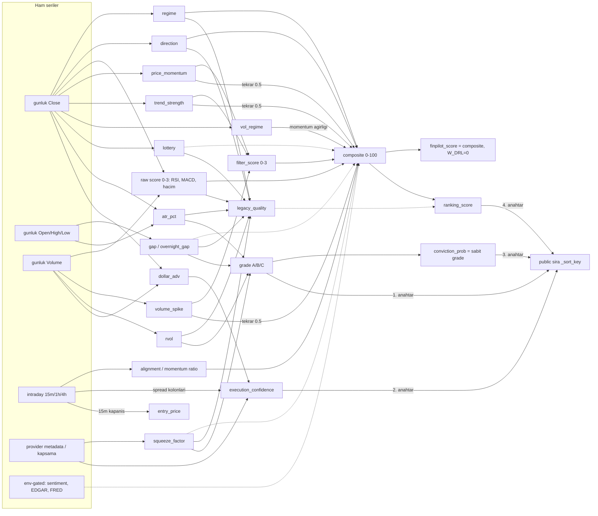

# R9 - Etkilesimler ve Gizli Bagimliliklar (Interactions and Hidden Dependencies)

| Alan | Deger |
|---|---|
| Baslik | R9 Interactions and Hidden Dependencies (brief WP-11) |
| Versiyon | v1 |
| Tarih | 2026-10-19 |
| Durum | DRAFT - Level A arastirma ciktisi; karar degildir |
| HEAD | 93ae83c (branch review/pending-2026-10-07) |
| Rol | Interactions and Hidden Dependencies (WP-11), PREFIX `INT` |
| Kapsam | Iliski haritasi (15.1), bilgi-bagimlilik grafigi (15.3), betimsel etkilesim problari (15.2), bilesenler arasi tutarlilik, sonraki testler |
| Girdiler | Kod (HEAD 93ae83c calisma agaci, salt-okunur), `data/finpilot.db` (salt-okunur, `mode=ro` + `PRAGMA query_only=ON`; SHA-256 `b64c0c5262e0d685daa1309e6293d27c208f64a6fc213b3c00e3cb896bd5f5f6`, mtime 2026-10-19T10:08:56Z) |

## Ozet

- Arsivin urun etiketi (`resolved_pct_barrier`) ile tarayici kodu arasinda iki gecerlilik riski var: resolver ayni gunde TP once sayar ve bosluklari bariyer fiyatinda keser, `scanner/labeling.py` ise SL once sayar (INT-03, P0, SUPPORTED); ts >= 4 gun sonra yazilan 1,639 satirlik tek kohort (11 sinyal gunu) brut kazanma payinda +0.125 [0.046, 0.202] fark gosteriyor (INT-08, P0, SUPPORTED; sonuc-sonrasi secim yorumu HYPOTHESIS).
- Ayni isimli alanlar farkli anlamlar tasiyor: `finpilot_score` (win rate / 0-1 yuvarlama / composite kopyasi; arsiv kolonu %100 NULL), `score` (arsivde en az 4 olcek), `regime` (arsivde 6 kodlama; mevcut yolun "Bull"/"Bear" kodlamasi hic yok) (INT-01, INT-02, INT-04, INT-07; MEASURED/SUPPORTED).
- Bilgi grafigi: public siralama 4 ham kaynak ailesine (gunluk fiyat yolu, gunluk hacim, intraday, provider metadata) + 0-3 env-gated kaynaga dayaniyor; `df_1d` en az 16 karar alaninin tek girdisi; ikinci siralama anahtari veri kapsamasi, ucuncusu grade-sabiti (INT-12, INT-15).
- Problar (brut, orneklem-ici, OOS degil): <5 USD hucresi brut ortalamada +4.58 puan fark gosteriyor ama TP/SL mesafesi ~5 kat genis ve TP-once kuraliyla etkilesimli olabilir (INT-09); skor x rejim etkilesimi kodlanmis kuralin turetildigi veriyle ortusebilir (INT-10); cok sinyalli gunler daha dusuk kazanma payi (INT-11, HYPOTHESIS). Momentum x likidite, volume spike x vol rejimi, gap x giris saklanan alanlarla NOT_MEASURABLE.
- Iptal eden bilesenler: bull rejim skoru +2 iterken boyutlandirma bull & yuksek skoru bastiriyor; catalyst lottery cezasini azaltiyor (INT-14).

## Kapsam ve yontem

- Kapsam: WP-11 teslimatlari 1-5 (iliski haritasi, bilgi-bagimlilik grafigi, betimsel etkilesim problari, bilesenler arasi tutarlilik, sonraki testler). Uretim kodu, konfig, `data/**`, diger raporlar ve decision-log degistirilmedi; diger rollerin dosyalari acilmadi.
- Kod: calisma agacindaki dosyalar `scripts/INT_discover.py` ile (regex tarama + satir araliklari) okundu; atif yapilan her satir cikti dosyalarinda gorulerek dogrulandi. Kodun varligi uretim davranisinin olcumu sayilmadi.
- Veri: `data/finpilot.db` yalniz `mode=ro` + `PRAGMA query_only=ON` ile acildi; ag/provider cagrisi, docker, tarayici veya yayin betigi calistirilmadi.
- Problar: `scripts/INT_probes.py`; sonuc yalniz `signal_date < 2026-08-01` satirlar icin SQL tarafinda yuklendi; gun-kumeli bootstrap (B=2000, sabit tohum). Etiketler en fazla SUPPORTED/HYPOTHESIS; hicbir sonuc OOS, net veya expectancy degildir.

## Bulgular

### INT-01 - `signals_archive.finpilot_score` kolonu tamamen bos

- Oncelik: P1 (ekonomik degerlendirme engeli: urunun `finpilot_score` alani arsivlenen sonuclarla eslestirilemiyor)
- Konum: `data/finpilot.db` tablo DDL `signals_archive` (kolonlar: id, symbol, ts, score, finpilot_score, payload_json, resolved_status, resolved_pct, resolved_pct_t5, resolved_pct_barrier, resolved_status_barrier)
- Veri kaynagi: `data/finpilot.db` (salt-okunur), SHA-256 `b64c0c5262e0d685daa1309e6293d27c208f64a6fc213b3c00e3cb896bd5f5f6`, boyut 7,811,072 bayt, mtime 2026-10-19T10:08:56Z (okuma anindaki dosya; canli DB oldugu icin degisebilir)
- Yontem/komut: `scripts/INT_discover.py all` -> `SELECT COUNT(DISTINCT finpilot_score), SUM(finpilot_score IS NULL) FROM signals_archive`
- Sonuc: distinct=0, NULL=5,748/5,748. Payload icinde de `finpilot_score` anahtari yok (37 ust-seviye anahtar sayildi); payload `score` anahtari 5,719 satirda var.
- n: 5,748 satir
- Etiket: MEASURED
- Sinirlamalar: canli DB; sonuc okuma anina aittir.
- Alternatif aciklamalar: kolon gelecekte kullanilmak uzere ayrilmis olabilir; skor baska bir tabloda tutuluyor olabilir.
- Sonraki adim: arsive yazan yollarin (archive bridge, migrasyon) hangi skor alanini hangi kolona yazdigini satir bazinda esle (INT-04'e bakiniz).
- Onerilen kategori: FIX_CANDIDATE (kalici kayit eksigi; uygulama Level B)

### INT-02 - `finpilot_score` / `filter_score` ayni isim, farkli anlam (scheduler vs scan router)

- Oncelik: P2
- Konum:
  - `core/scheduler.py:run_cycle_once:957-967` -> `scan_for_report[sym]["finpilot_score"] = bt_sym.get("win_rate", 0)` (backtest win rate; ayni fonksiyonda 719-720 yorumu win_rate'i 0-1 olcegi olarak tanimliyor, 725'te `kpi_tracker`'a `score_val * 100` yaziliyor).
  - `core/scheduler.py:run_cycle_once:1032-1033` -> legacy alert yukunde `"score": int(round(float(sig.get("finpilot_score", 0) or 0)))` (0-1 olcekli win rate'in tam sayiya yuvarlanmasi -> pratikte 0 veya 1) ve `"filter_score": 3` (sabit).
  - `core/scheduler.py:run_cycle_once:1006-1015` -> bu alert yolu `FINPILOT_ENABLE_LEGACY_SIGNAL_ALERTS == "1"` ve sistem degraded degilse calisir (varsayilan "0").
  - `api/routers/scan.py:_enrich_results:110,128-129` -> `r["finpilot_score"] = compute_finpilot_score(scanner_composite=int(r.get("composite_score") or 0), ...)` (tarayici composite tabanli skor).
  - `api/routers/scan.py:_auto_add_watchlist:289-293` -> watchlist satirinda `"score": float(r.get("filter_score") or r.get("score") or 0)`, `"finpilot_score": int(...)`, `"composite_score": int(...)`, `"regime": "Bull" if r.get("regime") else "Bear"`.
- Veri kaynagi: kod (HEAD 93ae83c calisma agaci)
- Yontem/komut: `scripts/INT_discover.py all` ciktisindaki satirlar okundu (`data/INT_discover_out.txt`).
- Sonuc: ayni isimli alan uc farkli nicelige karsilik geliyor: (a) scheduler'da backtest win rate (0-1), (b) legacy alert'te 0/1'e yuvarlanmis win rate, (c) scan router'da composite tabanli `compute_finpilot_score` ciktisi. `filter_score` scheduler'da sabit 3, scanner'da 0-3 arasi sayac (INT-04).
- n: kod yolu sayimi (3 anlam)
- Etiket: SUPPORTED (kod okumasi; uretimde legacy alert yolunun calisip calismadigi env degeri okunmadan NOT_MEASURABLE)
- Sinirlamalar: `bt_sym["win_rate"]` olceginin gercekten 0-1 oldugu yalniz ayni fonksiyondaki yoruma dayaniyor.
- Alternatif aciklamalar: legacy yol bilincli olarak kapali tutuldugu icin isim catismasi pratikte zararsiz olabilir; ReportAgent ciktisi ise her dongude bu `finpilot_score` degerini alir (963).
- Sonraki adim: `finpilot_score` icin tek bir sozlesme tanimi (olcek + kaynak) ve tum yazicilarin bu sozlesmeye gore test edilmesi.
- Onerilen kategori: FIX_CANDIDATE

### 1. Iliski haritasi (brief 15.1)

Tum kod referanslari HEAD 93ae83c calisma agacinda `scripts/INT_discover.py` (all / batch) ciktisinda satir satir okundu (`data/INT_discover_out.txt`, `data/INT_batch1_out.txt`). "Kanit" sutunu mekanizmanin kodda VAR oldugunu gosterir; uretim davranisinin olcumu degildir.

| # | Baglanti | Beklenen mekanizma | Destekleyen kanit (kod / veri) | Nasil test edilir | Alternatif aciklamalar | Testi bagimsiz tutma |
|---|---|---|---|---|---|---|
| M1 | provider -> data quality | Alpaca toplu birincil; yetersiz gecmiste yfinance sembol-bazli yedek; veri sozlesmesi spread/ADV/zaman damgasini doldurur | `scanner/data_fetcher.py:44` (yfinance = fallback), `:154-170` (Alpaca-miss sayaci), `:1155` (yetersiz Alpaca sonuclari yfinance ile doldurulur); `scanner/evaluate.py:_feature_contract:155-220` | Satir bazli provider kaynagi x eksik alan orani; ayni sembol/gun icin iki provider bar farki | Provider dususu likiditeyle karisik (IEX'te kisa gecmis = dusuk likidite) | Kaynagi tarama aninda kaydet; likidite kovasina gore tabakala (satir bazli provenance kaydi bu rolde dogrulanmadi) |
| M2 | data quality -> features | Kisa/eksik veri ozellikleri sessizce varsayilana ceker | `scanner/features.py:compute_vol_regime_from_df:377-378,381-382,389-390` (yetersiz veri veya hata -> 1); `scanner/evaluate.py:454,461` (varsayilan 1); `scanner/evaluate.py:202-205` (ADV icin >=5 gun) | Gunluk bar sayisi <21 olan satirlarda `vol_regime==1` oranini >=21 bar satirlarla karsilastir | Kisa gecmisli semboller gercekten normal volatilitede olabilir | RV'yi bagimsiz bir fiyat kaynagindan yeniden hesapla (INT-06) |
| M3 | features -> flags | Boolean bayraklar ve sayac | `scanner/evaluate.py:296-299` (volume_spike, price_momentum, trend_strength -> `filter_score` 0-3); `:479-516` (gap/rvol/lottery/overnight; hata -> 0.0) | Bayrak oranlarini ham ozellik esiklerinden yeniden uret | Esik degisiklikleri (config) bayrak oranini zamanla degistirir | Bayraklar ayni `df_1d`'den uretildigi icin bagimsiz kabul edilemez (bolum 2) |
| M4 | flags -> score | Toplamsal skor; ayni bayrak iki yoldan girer | `scanner/score_engine.py:117-145`: regime +2, direction +2, raw `score` x0.5, `filter_score` x1.5, alignment x2, momentum x vol-agirlik, her bayrak ayrica +0.5 | Bilesen ablasyonu; bilesenler arasi korelasyon | Cift sayim bilincli agirlik tercihi olabilir | Ablasyonu sabit, onceden kaydedilmis veri dondurmasiyla yap |
| M5 | score -> ranking | Birden fazla siralama tanimi birlikte var | `scanner/score_engine.py:378-397` (0-100 strength); `scanner/evaluate.py:605-607` (`ranking_score` = composite veya legacy_quality, env'e bagli); `core/pipeline.py:172-178` (`finpilot_score`, yoksa `composite_score`; ilk 5); `distribution/snapshot_builder.py:_sort_key:99-116` (grade, execution, -prob, -score) | Ayni tarama gunu icin tanimlar arasi sira korelasyonu | Farkli yuzeyler bilincli olarak farkli amaclara hizmet edebilir | Her yuzeyin siralamasini ayni dondurulmus satir kumesinde hesapla |
| M6 | ranking -> selection | Watchlist/arsiv secimi siraya degil uygunluga dayanir | `api/routers/scan.py:_auto_add_watchlist:253` (`selection_eligible`/`entry_ok`), `:256-268` (`score_floor` yalniz isaretler, eleme yok); `scanner/evaluate.py:592-594` (`selection_eligible = entry_ok AND execution_feasible`); `distribution/snapshot_builder.py:407-409` (`graded[:MAX_CANDIDATES]`) | Uygun ama secilmeyen vs secilen satirlarin skor dagilimi | Uygunluk filtresi zaten skorla iliskili olabilir | Secim kuralini sonuc verisine bakmadan sabitle |
| M7 | selection -> entry timing | Giris = tarama anindaki son 15m kapanis; bariyer penceresi sinyal gununden SONRAKI ilk islem gunuyle baslar | `scanner/evaluate.py:292,626`; `api/routers/scan.py:286,292` (`entry_price`, `signal_date` = UTC tarih); `scripts/resolve_open_signals.py:_resolve_symbol:221,240-242` | price_cache ile `entry_price` vs sinyal gunu kapanisi ve ertesi gun acilisi | Tarama saati EOD ise fark kucuk olabilir | Tarama saatine gore (EOD/intraday) ayri raporla |
| M8 | entry -> MFE/MAE | Arsiv MFE/MAE saklamaz; ayri etiketleyici hesaplar | `scanner/labeling.py:100-122`; `scripts/resolve_open_signals.py:_write_results:111-116` (yalniz t5, barrier pct/status) | Arsivden NOT_MEASURABLE; price_cache ile yeniden uretim | - | Yeniden uretimi arsiv etiketinden bagimsiz bar verisiyle yap |
| M9 | MFE/MAE -> exit design | TP/SL tarama aninda belirlenir; etiket iki degerli | `api/routers/scan.py:287-288`; `scripts/resolve_open_signals.py:252-260` | TP/SL mesafesi x MFE dagilimi (yeniden uretimle) | - | Cikis kuralini kesif ve degerlendirme verisinde ayir |
| M10 | exit -> costs | Arsiv etiketi brut; maliyet yalniz tarama tarafindaki beklenen getiriye uygulanir | `scripts/resolve_open_signals.py:254,260` (brut); `scanner/evaluate.py:_compute_cost_labels:130-152` | Etiketi maliyet varsayimlariyla yeniden fiyatla | - | Maliyet modelini sonuclara bakmadan sabitle |
| M11 | costs -> net expectation | `net_ev = ev_per_trade - cost`; etiket negatif/thin/edge_decay/ok | `scanner/evaluate.py:138-147,747-752` | `edge_label` x gerceklesen brut bariyer getirisi | `ev_per_trade` gecmis bar metriği; ileriye donuk degil | Etiketi tarama aninda dondur |
| M12 | regime -> all | Rejim skor, momentum agirligi, pozisyon boyutu, edge etiketi ve strateji secimine girer | `scanner/score_engine.py:118,138-141,357-375`; `scanner/evaluate.py:142,549`; `scanner/position_sizer.py:_regime_scale:32-44`; `core/scheduler.py:run_cycle_once:660-661`; temsil: `api/routers/scan.py:293` ("Bull"/"Bear") vs arsiv payload `regime` = 'True' (olculen ornek) | Rejim katmanli skor/sonuc tablolari (bolum 3, P7) | Rejim ile tarih/donem karisik | Gun-kumeli belirsizlik; donem bloklari |
| M13 | scanner speed -> data freshness | OHLCV cache TTL'i modul import aninda bir kez hesaplanir; ozellik cache 1 saat | `scanner/data_fetcher.py:_market_aware_ttl:193-210`, `:213-214` (modul seviyesi), `:218,408` (TTL baglanir); `scanner/features.py:43,403` (`_CACHE_TTL = 3600`) | Surec baslama saati x tarama aninda bar yasi | Uzun omurlu surec yeniden baslatiliyor olabilir | Bar yasini tarama aninda kaydet (INT-05) |
| M14 | data freshness -> signal quality | `feature_age_minutes` kaydedilir; scanner icinde tuketilmez | `scanner/evaluate.py:178,639-640`; `scanner/` grep'i: uretici disinda tuketici yok | `feature_age_minutes` x sonuc (arsiv payload'unda yok -> NOT_MEASURABLE) | Tuketici `scanner/` disinda olabilir (aranmadi) | Yasi sonuc etiketinden once dondur |

### INT-03 - Iki bariyer etiketleyicisi zit ayni-bar kurali kullaniyor; urun etiketi bosluklari bariyer fiyatinda kesiyor

- Oncelik: P0 (urun "gercegi" olarak sunulan `resolved_pct_barrier` etiketinin gecerliligi)
- Konum:
  - `scripts/resolve_open_signals.py:_resolve_symbol:239-260` -> pencere `d > sig_date` ve ilk 21 islem gunu (240-242); ayni bar icinde once TP kontrol edilir (252-256), sonra SL (258-260). Etiket degeri `(take_profit - entry_price)/entry_price*100` veya `(stop_loss - entry_price)/entry_price*100` (254, 260).
  - `scripts/resolve_open_signals.py:_resolve_symbol:186-196` -> yfinance `auto_adjust=True`, indirme bitisi `date.today()+1` (duzeltilmis ileri barlar, duzeltilmemis tarama-ani `entry_price`/TP/SL ile karsilastirilir).
  - `scanner/labeling.py:116-119` (+ docstring 70-71) -> ayni bar icinde SL kazanir ("conservative").
  - `core/scheduler.py:_run_resolve_open_signals_job:192-202` -> resolver haftalik zamanlanmis isle cagrilir.
- Veri kaynagi: kod
- Yontem/komut: `scripts/INT_discover.py batch` ile satirlar okundu (`data/INT_batch1_out.txt`).
- Sonuc: (a) ayni gun hem TP hem SL araliga girerse urun etiketi "win", `labeling.py` "sl" der; (b) acilis TP'nin ustunde ise etiket TP'de kesilir (gercek dolum daha iyi), SL'nin altinda ise SL'de kesilir (gercek dolum daha kotu) -> kayip kuyrugu sistematik olarak kirpilir; (c) etiket, cozumleme gunune kadar olan kurumsal islemlere (temettu/bolunme duzeltmesi) bagimli.
- n: 2 etiketleyici, 1 urun etiketi
- Etiket: SUPPORTED (kod). Etkinin buyuklugu bu rolde olculmedi -> NOT_MEASURABLE (bar verisi ile yeniden uretim gerekir).
- Sinirlamalar: hangi ayni-bar/bosluk durumunun ne siklikta oldugu bilinmiyor; `labeling.py` urun etiketini uretmiyor.
- Alternatif aciklamalar: TP-once kurali bilincli bir sadelestirme olabilir; gunluk bar ile sira zaten bilinemez.
- Sonraki adim: `data/price_cache` gunluk barlariyla karar verilmis satirlarda (i) ayni-gun TP&SL temas sikligini, (ii) acilisin TP/SL'yi astigi gun sikligini, (iii) SL-once ve acilis-dolumu kurallariyla brut ortalamanin nasil degistigini olc (onceden kaydedilmis, tek atis).
- Onerilen kategori: FIX_CANDIDATE (etiket sozlesmesi; uygulama Level B)

### INT-05 - Veri tazeligi tarama hizina degil surec baslangic saatine bagli (TTL import aninda donuyor)

- Oncelik: P3
- Konum: `scanner/data_fetcher.py:_market_aware_ttl:193-210` (piyasa saatinde 300 s, disinda 3600 s), `:213-214` (`CACHE_TTL_SECONDS = _market_aware_ttl()` modul seviyesinde), `:218` (`MemoryCache(default_ttl=CACHE_TTL_SECONDS)`), `:408` (`@_cache_data(ttl_seconds=CACHE_TTL_SECONDS)`); `scanner/features.py:43,403` (ozellik cache 3600 s).
- Veri kaynagi: kod
- Yontem/komut: `scripts/INT_discover.py all/batch` satir okumasi.
- Sonuc: piyasa disi saatte baslayan uzun omurlu bir surec, seans boyunca 3600 s TTL ile calisir (ve tersi). `vol_regime`/`squeeze_factor` ayrica 1 saatlik ozellik cache'inden gelir.
- n: 1 mekanizma
- Etiket: SUPPORTED (kod); uretimde surec omru ve bar yasi NOT_MEASURABLE (bu rolde log/servis okunmadi).
- Sinirlamalar: `_cache_data` icindeki L2/Redis davranisi okunmadi.
- Alternatif aciklamalar: surec her tarama icin yeniden baslatiliyorsa etki yok.
- Sonraki adim: tarama kayitlarinda `feature_age_minutes` (zaten uretiliyor) ile surec baslangic zamanini birlikte raporla; seans icinde >5 dk yas oranini olc.
- Onerilen kategori: RESEARCH_NEXT

### INT-06 - Veri eksikligi rejimi sessizce "normal"e ceker ve momentum agirligini belirler

- Oncelik: P2
- Konum: `scanner/features.py:compute_vol_regime_from_df:377-378,381-382,389-390` (bar <21, getiri <20 veya istisna -> 1); `scanner/evaluate.py:454,461-464` (varsayilan 1, istisnada 1 kalir); `scanner/score_engine.py:138-141` (`vol_regime` momentum agirligini secer); `scanner/evaluate.py:142` (`edge_decay` yalniz `vol_regime == 2`).
- Veri kaynagi: kod
- Yontem/komut: satir okumasi (`data/INT_batch1_out.txt`).
- Sonuc: veri kalitesi -> ozellik -> skor zincirinde eksik veri, "normal rejim" ile ayirt edilemez; eksik veri satirlari momentum agirligi 2.0 alir ve hicbir zaman `edge_decay` etiketi alamaz.
- n: 1 mekanizma
- Etiket: SUPPORTED (kod); sikligi NOT_MEASURABLE (arsiv payload'unda `vol_regime` yok).
- Sinirlamalar: tarama ihracatlarinda (data/distribution) bar sayisi alanlari bu rolde okunmadi.
- Alternatif aciklamalar: tarama evreni yeterli gecmisi olan sembollerle sinirliysa etki ihmal edilebilir.
- Sonraki adim: dondurulmus bir tarama ihracatinda `vol_regime==1` satirlarinin gunluk bar sayisi dagilimini olc; "unknown" icin ayri deger kullanilmasini Level B oneri olarak degerlendir.
- Onerilen kategori: FIX_CANDIDATE

### 2. Bilgi-bagimlilik grafigi (brief 15.3)

Kaynak satirlar: `scanner/evaluate.py:196-207,260-299,491-514,519-548,595-607,626`; `scanner/features.py:179,209-237,379-383,414-416`; `scanner/score_engine.py:117-160,278-300`; `scanner/finpilot_score.py:20-21,75-92`; `scanner/execution_policy.py:71-86`; `distribution/snapshot_builder.py:86-116`. Kesikli oklar env-gated yollardir (env degerleri kural geregi okunmadi). `alignment_ratio`/`momentum_ratio` girdi satirlari bu rolde okunmadi (UNRESOLVED).

Etkin bagimsiz bilgi kaynagi sayimi (kod yapisi; istatistiksel bagimsizlik olculmedi): public siralamanin arkasinda 4 ham kaynak ailesi vardir - (1) gunluk fiyat yolu (Close + Open/High/Low), (2) gunluk hacim, (3) intraday barlar, (4) provider metadata/kapsama - arti aktiflikleri bu rolde NOT_MEASURABLE olan 0-3 env-gated dis kaynak. Dogrulanan cagri yerlerine gore `df_1d` (gunluk OHLCV) en az 16 karar alaninin tek girdisidir: regime, direction, raw score, volume_spike, price_momentum, trend_strength, vol_regime, gap_factor, rvol_factor, extension_factor, dist_52w_high, gap_pct, rvol_daily, lottery_factor, overnight_gap_factor, dollar_adv. Ic ice gecme: `filter_score` uc bayragi icerir ve ayni bayraklar composite'e ayrica eklenir; `finpilot_score` scan yolunda composite'in kopyasidir; `conviction_prob` grade'in sabit fonksiyonudur. Etiket: SUPPORTED.

### INT-15 - Ayni bayraklar composite'e iki yoldan giriyor (ic ice ozellikler)

- Oncelik: P2
- Konum: `scanner/score_engine.py:compute_recommendation_score:128-130` (`filter_score` x1.5), `:143-145` (volume_spike/price_momentum/trend_strength ayrica +0.5); `scanner/evaluate.py:296-299` (`filter_score` = uc bayragin toplami); `scanner/evaluate.py:283-284` (ham `score` icinde ayrica hacim > 1.2 x medyan kosulu).
- Veri kaynagi: kod
- Yontem/komut: satir okumasi
- Sonuc: her bayrak composite'e toplam 2.0 puan katkiyla girer (1.5 + 0.5); hacim bilgisi ham skor, volume_spike ve filter_score uzerinden birden fazla kez girebilir (`check_volume_spike` tanimi okunmadi).
- n: 3 bayrak
- Etiket: SUPPORTED (kod)
- Sinirlamalar: agirliklarin bilincli secim olup olmadigi belgelenmemis; tanim satirlari kismen okunmadi.
- Alternatif aciklamalar: cift sayim kalibrasyonla telafi edilmis olabilir.
- Sonraki adim: dondurulmus ihracatta bilesenler arasi korelasyon ve tek-bilesen ablasyonu (onceden kaydedilmis).
- Onerilen kategori: RESEARCH_NEXT

### INT-12 - Public siralamada veri kapsamasi ve grade-sabiti olasilik skordan once geliyor

- Oncelik: P2
- Konum: `distribution/snapshot_builder.py:_sort_key:99-116` (anahtar sirasi: grade, `execution_confidence`, `-conviction_prob`, `-ranking_score` (yoksa legacy_quality/composite/score)); `:_grade_of:86-96`; `scanner/features.py:179,237` (`conviction_prob = _CONV_PROB[tier]`); `scanner/execution_policy.py:71-78` (Tier = spread_bps, dollar_adv, short_interest_timestamp mevcudiyeti).
- Veri kaynagi: kod
- Yontem/komut: satir okumasi (`data/INT_batch2_out.txt`)
- Sonuc: ayni grade icinde ikinci anahtar veri kapsamasidir (piyasa bilgisi degil); ucuncu anahtar grade verildiginde sabittir ve bilgi eklemez; skor ancak dorduncu anahtardir.
- n: 1 siralama fonksiyonu
- Etiket: SUPPORTED (kod)
- Sinirlamalar: `FINPILOT_ENABLE_CONVICTION_TIERS` degeri okunmadi; kapaliysa grade yalniz CONFIRM/TRIGGER tier'indan gelir.
- Alternatif aciklamalar: yurutulebilirlik onceligi bilincli urun tercihi olabilir.
- Sonraki adim: yeni veride grade icinde Tier 2 vs Tier 1 sonuc farkini likidite kontrollu olc.
- Onerilen kategori: RESEARCH_NEXT

### 3. Betimsel etkilesim problari (brief 15.2)

Yontem (`scripts/INT_probes.py`, cikti `data/INT_probes_out.txt`, hucre tablosu `data/INT_probe_cells.csv`): `signals_archive` salt-okunur; sonuc = brut `resolved_pct_barrier` (yuzde, maliyetsiz; net veya expectancy DEGILDIR) ve kazanma payi (`resolved_status_barrier` `_win` ile bitenler). Karar verilmis satir = durum {resolved_win, resolved_loss, expired_win, expired_loss} ve pct NULL degil. Gercek sinyal tarihi = payload `signal_date` (5,748/5,748 satirda var). `ts` arsiv-yazim zamani DEGIL: migrasyonda `ts = added_at or signal_date` (`scripts/migrate_signal_archive_to_sqlite.py:39`), bridge'de `ts = now` (`distribution/archive_bridge.py:55`). Gruplar: `same` (ts tarihi = signal_date), `late` (ts tarihi > signal_date), `early` (ts < signal_date; yalniz metadata). Belirsizlik: sinyal tarihine gore gun-kumeli bootstrap, B=2000, tohum `[20261019, probe, grup]`, %95 yuzdelik CI. Kilit: `signals_archive` icin tanimli kilitli/holdout bolum bulunamadi (`research/protocol.py:30-43` yalniz genel `TemporalSplit`; tarih atamasi grep'te yok); ihtiyaten `signal_date >= 2026-08-01` satirlarinda sonuc yuklenmedi (21 satir, hicbirinde etiket yok - yalniz sayim). D7 geregi hicbir sonuc OOS degildir; hepsi orneklem-ici betimseldir.

Metadata (sonuc icermez): 5,748 satir; `same` 3,929, `late` 1,639, `early` 180. Gecikme (gun): 0: 3,929; 4-7: 318; 8-14: 724; 15-29: 491; 30+: 106; <0: 180; 1-3 gun hic yok. 1,639 `late` satirin tamami `ts` saati 21:45 olan kohortta; 2,065 satir 09:00 kohortu (`source_model=scanner_import`, `entry_ok` anahtari yalniz bunlarda). Karar verilmis (kesim oncesi): same 3,417, late 1,621, early 178. Kesim oncesi 53 sinyal gunu; gun basina satir min 4 / medyan 50 / maks 496 (tercile sinirlari 49.3 ve 153).

Desteklenmeyen problar (saklanan alanlar yetersiz): momentum x likidite, volume spike x volatilite rejimi, overnight gap x giris -> NOT_MEASURABLE. 5,719 watchlist-kaynakli satirin payload'unda momentum/likidite/volume spike/vol_regime/gap alani yok; `metrics` (momentum_3d_pct, volume_multiple) yalniz 29 bridge satirinda var ve bunlarin hicbirinde bariyer etiketi yok.

| Prob | Grup | Hucre | n | gun | ort. brut % [CI] | win payi [CI] | medyan % | TP med % | SL med % |
|---|---|---|---|---|---|---|---|---|---|
| P0 arsiv zamani | tum | same | 3417 | 33 | 0.221 [-0.030, 0.500] | 0.265 [0.226, 0.308] | -0.595 | 1.94 | -0.85 |
| P0 arsiv zamani | tum | late | 1621 | 11 | 0.848 [0.245, 1.263] | 0.389 [0.322, 0.462] | -0.870 | 4.02 | -1.48 |
| P4 gunluk sinyal sayisi | same | dusuk tercile | 183 | 9 | 0.711 [-0.247, 1.326] | 0.415 [0.271, 0.491] | -0.417 | 1.90 | -0.78 |
| P4 | same | orta | 1196 | 14 | 0.227 [-0.079, 0.562] | 0.293 [0.230, 0.370] | -0.611 | 2.00 | -0.86 |
| P4 | same | yuksek | 2038 | 10 | 0.174 [-0.245, 0.606] | 0.234 [0.177, 0.284] | -0.599 | 1.92 | -0.85 |
| P4 | late | dusuk | 106 | 5 | 0.319 [0.248, 0.421] | 0.613 [0.500, 0.667] | 0.451 | 0.93 | -0.46 |
| P4 | late | orta | 90 | 1 | -0.314 [tek gun] | 0.156 [tek gun] | -1.025 | 3.06 | -1.15 |
| P4 | late | yuksek | 1425 | 5 | 0.961 [0.388, 1.407] | 0.387 [0.324, 0.442] | -0.997 | 4.38 | -1.62 |
| P5 fiyat | same | >=5 USD | 3253 | 33 | 0.001 [-0.179, 0.215] | 0.253 [0.215, 0.301] | -0.595 | 1.86 | -0.82 |
| P5 | same | <5 USD | 164 | 13 | 4.585 [1.253, 5.459] | 0.488 [0.453, 0.778] | -1.477 | 10.07 | -3.94 |
| P5 | late | >=5 USD | 1438 | 11 | 0.668 [0.216, 1.066] | 0.378 [0.318, 0.451] | -0.864 | 3.76 | -1.38 |
| P5 | late | <5 USD | 183 | 5 | 2.261 [1.235, 2.749] | 0.481 [0.386, 0.550] | -1.344 | 6.75 | -2.48 |
| P6 veri tamligi | same | <=1 alan | 2842 | 17 | 0.172 [-0.122, 0.485] | 0.247 [0.208, 0.284] | -0.583 | 1.69 | -0.81 |
| P6 | same | >=2 alan | 575 | 17 | 0.466 [-0.179, 1.063] | 0.351 [0.233, 0.460] | -0.718 | 3.42 | -1.11 |
| P6 | late | <=1 alan | 1515 | 6 | 0.885 [0.241, 1.334] | 0.374 [0.290, 0.428] | -1.004 | 4.26 | -1.55 |
| P6 | late | >=2 alan | 106 | 5 | 0.319 [0.248, 0.441] | 0.613 [0.500, 0.667] | 0.451 | 0.93 | -0.46 |
| P7 skor x rejim | same | dusuk skor, bear | 986 | 24 | 0.220 [-0.105, 0.541] | 0.251 [0.209, 0.290] | -0.591 | 1.61 | -0.78 |
| P7 | same | dusuk skor, bull | 1540 | 25 | 0.133 [-0.030, 0.348] | 0.275 [0.234, 0.324] | -0.522 | 1.56 | -0.74 |
| P7 | same | yuksek skor, bear | 354 | 17 | 0.864 [-0.459, 2.119] | 0.266 [0.132, 0.401] | -0.887 | 3.90 | -1.33 |
| P7 | same | yuksek skor, bull | 245 | 16 | -0.348 [-0.624, 0.494] | 0.159 [0.091, 0.291] | -0.924 | 3.26 | -1.08 |
| P7 | late | dusuk skor, bear | 476 | 6 | 1.725 [1.262, 1.952] | 0.473 [0.432, 0.502] | -0.934 | 5.59 | -2.17 |
| P7 | late | dusuk skor, bull | 702 | 6 | 0.200 [-0.398, 0.763] | 0.302 [0.190, 0.378] | -1.049 | 3.45 | -1.25 |
| P7 | late | yuksek skor, bear | 155 | 6 | 1.958 [0.494, 3.257] | 0.465 [0.327, 0.554] | -0.984 | 5.44 | -2.04 |
| P7 | late | yuksek skor, bull | 182 | 6 | 0.414 [-0.096, 0.916] | 0.313 [0.229, 0.387] | -0.859 | 3.73 | -1.16 |

Tanimlar: P4 tercile = sinyal gunundeki toplam arsiv satiri; P5 = payload `entry_price`; P6 = {risk_reward>0, explanation dolu, reason dolu, sentiment sayisal} icinden dolu alan sayisi; P7 = payload `score` yalniz 0-3 olcekli satirlarda (>=2 yuksek) x payload `regime` ('True'/'1' bull, 'False'/'0' bear; 'Trend'/'Range' disarida).

| Kontrast | Grup | ort. fark [CI] | win farki [CI] |
|---|---|---|---|
| P0 late - same | tum | 0.627 [-0.027, 1.119] | 0.125 [0.046, 0.202] |
| P4 yuksek - dusuk | same | -0.538 [-1.341, 0.479] | -0.181 [-0.273, -0.038] |
| P4 yuksek - dusuk | late | 0.642 [0.078, 1.097] | -0.226 [-0.301, -0.115] |
| P5 <5 - >=5 | same | 4.584 [1.167, 5.341] | 0.235 [0.174, 0.505] |
| P5 <5 - >=5 | late | 1.593 [0.802, 2.243] | 0.103 [-0.000, 0.191] |
| P6 >=2 - <=1 | same | 0.294 [-0.419, 0.960] | 0.104 [-0.026, 0.219] |
| P6 >=2 - <=1 | late | -0.566 [-1.005, 0.069] | 0.240 [0.137, 0.334] |
| P7 yuksek - dusuk (bull) | same | -0.481 [-0.766, 0.326] | -0.115 [-0.185, 0.001] |
| P7 yuksek - dusuk (bear) | same | 0.644 [-0.484, 1.678] | 0.015 [-0.114, 0.135] |
| P7 etkilesim | same | -1.125 [-1.989, 0.217] | -0.131 [-0.197, -0.023] |
| P7 yuksek - dusuk (bull) | late | 0.213 [-0.322, 1.060] | 0.011 [-0.071, 0.149] |
| P7 yuksek - dusuk (bear) | late | 0.233 [-0.862, 1.482] | -0.008 [-0.147, 0.099] |
| P7 etkilesim | late | -0.020 [-1.750, 1.885] | 0.019 [-0.167, 0.298] |

Coklu test notu: 24 hucre ve 13 kontrast (her kontrastta 2 metrik = 26 aralik) incelendi; duzeltme uygulanmadi. Rastlantiyla ~1.3 araligin 0'i dislamasi beklenir; 9 aralik 0'i disliyor, ancak hucreler yazici kohortu, TP/SL geometrisi ve az gun sayisiyla (5-11 gunluk hucreler) karisik oldugundan bu fazlalik bir etki kaniti sayilmamalidir. Az kumeli (<~20 gun) yuzdelik bootstrap araliklari belirsizligi olduğundan dar gosterebilir. P6 yorumlanamaz: `late` grubunda `>=2 alan` hucresi P4 dusuk-tercile hucresiyle ayni 106 satirdir (yazici kohortu = tamlik).

### INT-04 - `score` kolonu en az dort farkli olcegi karistiriyor

- Oncelik: P1 (arsiv uzerinde her skor-bazli sonuc analizi farkli kavramlari karistirir)
- Konum: `api/routers/scan.py:_auto_add_watchlist:289` (`score = filter_score or score`); `scanner/evaluate.py:276-290` (ham `score` 0-3: RSI/hacim/MACD) ve `:296-299` (`filter_score` 0-3); `distribution/archive_bridge.py:archive_snapshot_candidates:88` (`score = watchlist score or metrics.conviction_prob`); `scanner/features.py:179` (`_CONV_PROB = {"A": 0.73, "B": 0.59, "C": 0.52}`); `scripts/migrate_signal_archive_to_sqlite.py:40`.
- Veri kaynagi: `data/finpilot.db` (SHA-256 INT-01'de)
- Yontem/komut: `scripts/INT_probes.py` metadata bolumu
- Sonuc: tablo `score`: 0-3 tam sayi 4,800 satir (signal_date 2025-09-12..2026-05-12; 1: 2,723, 0: 1,058, 2: 902, 3: 117); >3: 943 satir (2025-10-07..2026-09-09; en sik 60, 62, 64, 58, 51, 56, 55, 7.6); (0,1) kesir: 2 satir (0.59, 2026-08-24 = tier B `conviction_prob` sabiti); diger: 3. Tablo `score` = payload `score` her iki alanin oldugu 5,719 satirin tamaminda.
- n: 5,748
- Etiket: MEASURED (dagilim); her olcegin hangi yazicidan geldigi SUPPORTED (kod), satir bazinda izlenmedi.
- Sinirlamalar: >3 grubu hem 0-100 benzeri degerleri hem 7.6 gibi farkli olcekli degerleri iceriyor.
- Alternatif aciklamalar: zaman icinde degisen yazici surumleri (olcek, tarihle karisik).
- Sonraki adim: her skora `score_kind`/olcek etiketi; arsiv analizlerinde olcege gore zorunlu tabakalama.
- Onerilen kategori: FIX_CANDIDATE

### INT-07 - `regime` ve `signal` alanlari yaziciya gore farkli kodlaniyor; mevcut kod yolunun kodlamasi arsivde hic yok

- Oncelik: P1 (arsiv mevcut tarayici kodunun ciktisi olarak okunamaz)
- Konum: `api/routers/scan.py:_auto_add_watchlist:293` (mevcut yol "Bull"/"Bear" yazar); `scanner/evaluate.py:269` (`regime = c_daily > e200_daily`, boolean); `core/scheduler.py:run_cycle_once:660-661` (`"bull" in str(regime_str).lower()`).
- Veri kaynagi: `data/finpilot.db`
- Yontem/komut: `scripts/INT_probes.py` metadata
- Sonuc: payload `regime`: 'True' 2,827; 'False' 1,767; '0' 350; 'Trend' 335; 'Range' 228; '1' 211; 'None' 29; '' 1. 'Bull'/'Bear' degeri 0 satir. `signal`: 'WATCH' 2,813; 'TRUE' 1,326; 'BUY' 841; 'FALSE' 739; 'None' 29. Kaynak: scanner_v1 2,531; scanner_import 2,065; scanner_v2 564; scanner_shortlist 559; publish_archive_bridge 29.
- n: 5,748
- Etiket: MEASURED (sayimlar); 'Trend'/'Range'in bull/bear'den farkli bir kavram oldugu HYPOTHESIS (yalniz isimden).
- Sinirlamalar: kaynak x kodlama capraz tablosu bu rolde uretilmedi.
- Alternatif aciklamalar: arsiv eski JSON arsivlerinden migrasyonla geldi; mevcut yol arsive dogrudan yazmiyor olabilir.
- Sonraki adim: arsiv satirlarini yazici surumune gore etiketle; rejim icin tek sozlesme.
- Onerilen kategori: FIX_CANDIDATE

### INT-08 - Gec yazilan kohort daha yuksek brut kazanma payi gosteriyor (olasi sonuc-sonrasi secim)

- Oncelik: P0 (gecerlilik)
- Konum: `scripts/migrate_signal_archive_to_sqlite.py:39` (`ts = added_at or signal_date`); `api/routers/scan.py:_auto_add_watchlist:292,298` (mevcut yolda `signal_date` ve `added_at` ayni `_now`'dan -> tarih farki beklenmez); `scripts/resolve_open_signals.py:_resolve_symbol:240-242` (pencere `ts`'den bagimsiz olarak signal_date'ten sonra baslar).
- Veri kaynagi: `data/finpilot.db`
- Yontem/komut: `scripts/INT_probes.py` P0
- Sonuc: `late` (ts >= 4 gun sonra, tamami 21:45 kohortu, 11 sinyal gunu) win payi 0.389 [0.322, 0.462] vs `same` 0.265 [0.226, 0.308]; fark 0.125 [0.046, 0.202]. Ortalama brut fark 0.627 [-0.027, 1.119]. Iki grupta da medyan negatif (-0.870, -0.595). Medyan TP/SL: same 1.94/-0.85, late 4.02/-1.48. Kaba surüklenmesiz referans |SL|/(TP+|SL|) (medyanlardan): same ~0.30, late ~0.27; `late` gozlenen pay referansin ustunde, `same` altinda. 106 satirda gecikme >=30 gun (21 islem gunluk pencere yazim aninda buyuk olcude gecmis).
- n: 3,417 + 1,621 karar verilmis satir; 44 gun
- Etiket: SUPPORTED (grup farki); sonuc-sonrasi secim yorumu HYPOTHESIS.
- Sinirlamalar: `late` = tek yazici kohortu ve 11 gun; TP/SL geometrisi farkli; referans zaman bariyerini ve surüklenmeyi yok sayar.
- Alternatif aciklamalar: farkli donem/piyasa kosulu; watchlist upsert'inin `added_at`'i yenilemesi (`api/routers/watchlist.py:170` `_upsert`, ic mantigi bu rolde okunmadi).
- Sonraki adim: `late` satirlarda `entry_price`'i price_cache'teki signal_date kapanisi ve ts-gunu kapanisiyla karsilastir; degerlendirmelerde `ts > signal_date` satirlarini onceden kaydedilmis kuralla ayir.
- Onerilen kategori: FIX_CANDIDATE (gercek yazim zamani provenance'i) + RESEARCH_NEXT

### INT-09 - Fiyat <5 USD x sonuc: buyuk brut fark TP/SL geometrisi ve TP-once kuraliyla karisik

- Oncelik: P1
- Konum: veri; mekanizma `scripts/resolve_open_signals.py:252-260` (INT-03)
- Veri kaynagi: `data/finpilot.db`
- Yontem/komut: `scripts/INT_probes.py` P5
- Sonuc: `same`: <5 USD n=164 (13 gun) ort. 4.585 [1.253, 5.459], win 0.488 [0.453, 0.778], medyan -1.477, TP/SL medyan 10.07/-3.94; >=5 USD n=3,253 ort. 0.001 [-0.179, 0.215], win 0.253, medyan -0.595, TP/SL 1.86/-0.82. `late`: fark 1.593 [0.802, 2.243].
- n: 3,417 (same) + 1,621 (late)
- Etiket: SUPPORTED (betimsel brut fark); mekanizma HYPOTHESIS: genis gunluk araliklarda ayni-bar TP&SL temasi sik olur ve resolver bunlari "win" sayar (INT-03); kaba referans 3.94/(10.07+3.94) ~0.28 iken gozlenen 0.488.
- Sinirlamalar: brut; dusuk fiyatli hisselerde spread/maliyet repoda yok; 13 gun.
- Alternatif aciklamalar: gercek yuksek volatilite primi; az sayida gunde yogunlasmis olaylar.
- Sonraki adim: onceden kaydedilmis tek atis: price_cache ile SL-once ve acilis-dolumu kurallariyla <5 / >=5 farkini yeniden hesapla.
- Onerilen kategori: RESEARCH_NEXT

### INT-10 - Skor x rejim etkilesimi (same kohortu) kodlanmis kuralla ayni veriden turemis olabilir

- Oncelik: P2
- Konum: `scanner/position_sizer.py:_regime_scale:32-44` (docstring "from barrier audit 2026-06-12": bull & composite>62 -> 0.75, bear & 30-55 -> 1.30); `scanner/score_engine.py:regime_gate_mult:357-375`; `scanner/evaluate.py:518` (yorum: "Regime x score-band gate (2026-06-12 barrier audit findings)").
- Veri kaynagi: `data/finpilot.db`
- Yontem/komut: `scripts/INT_probes.py` P7
- Sonuc: `same`: yuksek skor & bull win 0.159 [0.091, 0.291] vs dusuk skor & bull 0.275; etkilesim (win) -0.131 [-0.197, -0.023], (ort.) -1.125 [-1.989, 0.217]. `late` (6 gun): etkilesim yok gibi (araliklar genis).
- n: 3,125 (same, 0-3 olcekli + rejim bilinen) ; 1,515 (late)
- Etiket: HYPOTHESIS. Buradaki `score` 0-3 olcekli payload alani (INT-04), kodlanmis kuraldaki 0-100 composite degil; ayrica 0-3 olcekli satirlar 2025-09-12..2026-05-12 arasinda ve 2026-06-12 denetimiyle ortusuyor olabilir -> bagimsiz dogrulama degil.
- Sinirlamalar: tek kohortta gorulen etki, diger kohortta yok.
- Alternatif aciklamalar: donemsel rejim kompozisyonu; or-zinciri nedeniyle `score`un iki farkli yapiyi karistirmasi.
- Sonraki adim: kural dondurulduktan sonraki yeni veride onceden kaydedilmis test.
- Onerilen kategori: NEEDS_MORE_DATA

### INT-11 - Cok sinyalli gunlerde kazanma payi dusuk (gun-seviyesi ortak sok)

- Oncelik: P2
- Konum: veri (gun-seviyesi degisken)
- Veri kaynagi: `data/finpilot.db`
- Yontem/komut: `scripts/INT_probes.py` P4
- Sonuc: `same`: yuksek tercile win 0.234 [0.177, 0.284] vs dusuk 0.415 [0.271, 0.491]; fark -0.181 [-0.273, -0.038]; TP/SL medyanlari tercile'ler arasinda benzer (1.90-2.00 / -0.78..-0.86). `late`: fark -0.226 [-0.301, -0.115] ama TP medyani 0.93 vs 4.38 (geometri karisik).
- n: 3,417 / 1,621; tercile basina 9-14 gun (same)
- Etiket: HYPOTHESIS (gun sayisi az)
- Sinirlamalar: sinyal sayisi tarama evreni buyuklugu ve yazici kohortuyla karisik.
- Alternatif aciklamalar: genis taramalarin yapildigi gunlerin piyasa kosulu.
- Sonraki adim: yeni veride gunluk sinyal sayisini onceden kaydedilmis kovalarla ve evren buyuklugune oranla test et.
- Onerilen kategori: RESEARCH_NEXT

### 4. Bilesenler arasi tutarlilik

| Alan | Yol A | Yol B / C | Kanit | Etiket |
|---|---|---|---|---|
| `finpilot_score` | scheduler: backtest `win_rate` (0-1) (`core/scheduler.py:963`); legacy alert: `int(round(...))` (`:1032`) | scan router: `compute_finpilot_score(composite)` = composite (W_DRL=0) (`api/routers/scan.py:128-133`, `scanner/finpilot_score.py:20-21,75-92`); pipeline siralama anahtari, yoksa composite (`core/pipeline.py:172-178`); arsiv kolonu 5,748/5,748 NULL | kod + DB | SUPPORTED / MEASURED |
| `filter_score` | scanner: 3 bayrak toplami 0-3 (`scanner/evaluate.py:299`) | scheduler legacy alert: sabit 3 (`core/scheduler.py:1033`) | kod | SUPPORTED |
| `score` | ham 0-3 (`scanner/evaluate.py:276-290`); watchlist: `filter_score or score` (`api/routers/scan.py:289`) | bridge: watchlist score veya `conviction_prob` (`distribution/archive_bridge.py:88`); kpi: `win_rate*100` (`core/scheduler.py:725`); arsivde 4+ olcek (INT-04) | kod + DB | SUPPORTED / MEASURED |
| `calibrated_probability` girdisi | `run_cycle_once`: `score_val` = win_rate 0-1 (`core/scheduler.py:706,718`) | `_run_auto_approve_job`: kayitli `score` (0-100 olcekte yazilan, `:725`) (`:387-390`) | kod (fonksiyon icindeki normalizasyon okunmadi) | SUPPORTED (kod farki); etki HYPOTHESIS |
| `regime` | scanner boolean (`scanner/evaluate.py:269`) | watchlist "Bull"/"Bear" (`api/routers/scan.py:293`); scheduler `"bull" in str(...)` (`core/scheduler.py:661`); arsivde 6 kodlama, "Bull"/"Bear" hic yok (INT-07) | kod + DB | SUPPORTED / MEASURED |
| `entry_price` | scanner: son 15m kapanis (`scanner/evaluate.py:292,626`; `api/routers/scan.py:286`) | scheduler: `bt_sym["final_value"]` (`core/scheduler.py:705`); bridge: watchlist entry veya `metrics.price` (`distribution/archive_bridge.py:70`) | kod | SUPPORTED; `final_value` anlami UNRESOLVED |
| bariyer etiketi | resolver: ayni bar TP once (`scripts/resolve_open_signals.py:252-260`) | `scanner/labeling.py:116-119`: SL once | kod | SUPPORTED (INT-03) |

### INT-13 - Scheduler KPI/paper yolunda fiyat ve skor olcekleri tutarsiz

- Oncelik: P1 (paper portfoy ve KPI kayitlari ekonomik degerlendirme yuzeyi)
- Konum: `core/scheduler.py:run_cycle_once:671` (`initial_capital=10_000`), `:702-706` (`direction` = total_return isareti, `entry_price = final_value`, `score_val = win_rate`), `:718-729` (`p_win = calibrated_probability(score_val)`, `record_signal(price=entry_price, score=score_val*100)`), `:755-766` (`open_position(entry_price=entry_price, ...)`); `core/scheduler.py:_run_auto_approve_job:387-390,402-407` (kayitli `score` ile `calibrated_probability`; `entry_price = sig.get("price")`).
- Veri kaynagi: kod; `agents/backtest_agent.py` grep'inde `final_value` adi gecmiyor (sonuc semasi okunmadi)
- Yontem/komut: satir okumasi + `INT_discover.py batch` grep
- Sonuc: paper pozisyon ve KPI kaydinin "fiyat" alani backtest `final_value` alanidir; adi ve 10,000 baslangic sermayesi portfoy degerini dusunduruyor. Ayni dosyada kalibrasyon fonksiyonu bir yerde 0-1, diger yerde 0-100 olcekli girdiyle cagriliyor.
- n: 2 kod yolu
- Etiket: HYPOTHESIS (`final_value` anlami ve `calibrated_probability` icindeki olcek islemi UNRESOLVED); kod farki SUPPORTED.
- Sinirlamalar: `core/backtest.py` sonuc semasi ve `core/calibration.py` okunmadi; yolun uretimde calisip calismadigi olculmedi.
- Alternatif aciklamalar: `final_value` son fiyat olabilir; kalibrasyon girdisini kendi icinde normalize ediyor olabilir.
- Sonraki adim: backtest sonuc semasini ve `calibrated_probability` girdisini birim testleriyle sabitle.
- Onerilen kategori: NEEDS_MORE_DATA (dogrulanirsa FIX_CANDIDATE)

### INT-14 - Birbirini kismen iptal eden bilesenler

- Oncelik: P2
- Konum: `scanner/score_engine.py:118` (bull rejim composite'e +2) vs `scanner/position_sizer.py:_regime_scale:40-41` (bull & composite>62 -> boyut 0.75) ve `scanner/score_engine.py:regime_gate_mult:372-374` (bull & yuksek skor -> bastirma carpani); `scanner/score_engine.py:293-294` (catalyst > 0.3 iken lottery cezasi %50'ye kadar azaltilir); `scanner/score_engine.py:155-160,278-290` (FRED makro carpani squeeze/catalyst'i sondurur).
- Veri kaynagi: kod; P7 betimsel tablo (yuksek skor & bull hucresi en dusuk win payi 0.159, same kohortu)
- Yontem/komut: satir okumasi + `INT_probes.py` P7
- Sonuc: rejim skoru yukari iterken boyutlandirma ayni (bull, yuksek skor) hucresini asagi iter; lottery ve catalyst ayni satirda zit yonlu ve aciktan etkilesimli.
- n: 3 iptal mekanizmasi
- Etiket: SUPPORTED (kod); net etki NOT_MEASURABLE (arsivde bilesenler yok); P7 baglantisi HYPOTHESIS (INT-10).
- Sinirlamalar: `_HIGH_SCORE_THRESH` vb. sabitlerin degerleri okunmadi; `_gate_mult`'in sonraki kullanimi izlenmedi.
- Alternatif aciklamalar: bilincli "skorla sec, boyutla sinirla" tasarimi.
- Sonraki adim: dondurulmus ihracatta (bull, composite>62) hucresinin pay ve boyut dagilimini raporla.
- Onerilen kategori: RESEARCH_NEXT

### 5. Sonraki test edilmeye deger beklenmedik baglantilar (onceden belirlenmis testler)

| # | Baglanti | Onceden belirlenmis test (tek atis, sonuclara bakmadan sabit) | Birincil metrik | Ilgili bulgu |
|---|---|---|---|---|
| L1 | etiket kurali x fiyat seviyesi | Karar verilmis, kesim oncesi satirlarda `data/price_cache` gunluk barlariyla bariyeri yeniden oynat: (a) ayni-gun TP&SL temasi orani, (b) acilisin TP/SL'yi astigi gun orani, (c) SL-once ve acilis-dolumu kurallariyla brut ortalama ve win payi; <5 / >=5 USD ayri | <5 USD win payindaki degisim | INT-03, INT-09 |
| L2 | arsiv yazim gecikmesi x sonuc | `late` satirlarda `entry_price`'i signal_date ve ts-gunu kapanislariyla karsilastir (mutlak fark < %0.5 esigi onceden sabit) | ts-gunu ile eslesen satir orani | INT-08 |
| L3 | surec baslangic saati x veri tazeligi | Tarama ihracatlarindaki `feature_age_minutes` (15m) > 20 dk orani, seans icinde ve surec omrune gore (sonuc kullanilmaz) | seans ici bayat bar orani | INT-05 |
| L4 | veri kapsamasi (execution tier) x siralama x sonuc | Yeni veride grade icinde Tier 2 vs Tier 1 brut bariyer farki, dollar_adv kovasina gore tabakali | tabakali fark ve gun-kumeli CI | INT-12 |
| L5 | eksik veri -> vol_regime=1 | Dondurulmus ihracatta gunluk bar sayisi <21 vs >=21 icin vol_regime dagilimi (sonuc kullanilmaz) | <21 bar grubunda vol_regime=1 orani | INT-06 |
| L6 | gunluk sinyal sayisi x sonuc | Yeni veride gun seviyesinde win payi ~ log(sinyal/evren); gun-kumeli CI | egim | INT-11 |
| L7 | kurumsal islemler x etiket | Signal_date ile cozumleme tarihi arasinda bolunme/temettu olan satirlarda saklanan etiket vs duzeltmesiz yeniden oynatma | etiket uyusmazlik orani | INT-03 |

<!-- BULGULAR_SONU -->

## Dogru calisan kisimlar

Kod incelemesiyle dogrulanan, niyet edilen davranisa uyan kisimlar (KEEP_AS_IS; uretim etkisi olculmedi):

- `distribution/archive_bridge.py:archive_snapshot_candidates:49-50,64,80-83` - DB hatasi gorunur sekilde yukselir; sembol+tarih bazli deterministik id ve `INSERT OR IGNORE` ile idempotent yazim.
- `scripts/resolve_open_signals.py:_write_results:111-122` - yalniz cozulmemis durumlar guncellenir; mevcut `resolved_pct` `COALESCE` ile korunur.
- `scanner/labeling.py:73-78,116-119` - girdi dogrulamasi ve muhafazakar ayni-bar kurali.
- `scanner/execution_policy.py:execution_contract:59-69` - eksik veri sifirla doldurulmaz; uyarilar uretilir.
- `scanner/evaluate.py:_feature_contract:163-178` - zaman dilimi bazinda ozellik zaman damgasi ve yas kaydi (tazelik provenance'i mevcut).
- `scanner/finpilot_score.py:compute_finpilot_score:73-76` - DRL yoksa sahte/stale varsayilan kullanilmaz; 0-100 sinirlanir.
- `scanner/features.py:get_alpha_features:407-412` - vol_regime zaten alinan `df_1d`'den hesaplanir (gereksiz ag cagrisi yok).
- `distribution/snapshot_builder.py:_public_candidate:123-131` - uygun olmayan / yurutulemez / limit-reddi satirlar public listeye girmez.
- Arsiv tutarliligi (MEASURED): `signal_date` 5,748/5,748 satirda var; tablo `score` = payload `score` 5,719/5,719 satirda.

## Cevaplanamayan sorular

- Backtest `final_value` alaninin anlami ve `calibrated_probability`'nin girdi olcegini normalize edip etmedigi (INT-13) - UNRESOLVED.
- Uretimde hangi env bayraklarinin acik oldugu (conviction tier, legacy alert, squeeze/lottery/overnight, execution policy) - kural geregi okunmadi, NOT_MEASURABLE.
- 21:45 `late` kohortunu hangi yazicinin urettigi; kaynak x grup capraz tablosu - uretilmedi.
- `alignment_ratio`/`momentum_ratio` girdileri, `check_volume_spike` tanimi, `_HIGH_SCORE_THRESH` sabitleri, `_gate_mult`'in sonraki kullanimi, `api/routers/watchlist.py:_upsert` (170) ic mantigi - okunmadi.
- INT-03 kurallarinin etki buyuklugu (bar yeniden oynatma gerekir).
- Arsiv satirlari icin MFE/MAE (saklanmiyor) ve satir bazli provider provenance'i.
- P6 (veri tamligi x sonuc): yazici kohortuyla tamamen karisik oldugu icin yorumlanamadi.

## Sinirlamalar

- Tum problar orneklem-ici ve betimseldir (D7: mevcut hicbir veri OOS sayilmaz); sonuc brut bariyer getirisidir, maliyet yoktur.
- Kume sayisi az (bazi hucrelerde 1-6 gun; `late` toplam 11 gun); yuzdelik bootstrap az kumede belirsizligi dar gosterebilir.
- Yazici kohortu, TP/SL geometrisi ve donem tum problarla karisiktir; hucre farklari nedensel yorumlanamaz.
- `signals_archive` icin kilitli bolum tanimi bulunamadi; ihtiyaten `signal_date >= 2026-08-01` (21 satir, etiketsiz) disarida birakildi.
- DB canli: SHA-256 kesif aninda alindi; son kontrolde `Get-FileHash` dosya baska bir surec tarafindan kullanildigi icin okuyamadi, mtime her iki anda 2026-10-19T10:08:56.26Z (degismemis olmasi icerigin ayni oldugunu kanitlamaz).
- Calisma agaci kirli; kod HEAD 93ae83c ile birebir karsilastirilmadan calisma agacindan okundu.
- Statik kod okumasi uretim davranisini olcmez; tarayici/zamanlayici calistirilmadi.
- Arac butcesi nedeniyle bazi tanim dosyalari okunmadi (Cevaplanamayan sorular).

## Ek: komutlar

Python: `C:\Users\meric\AppData\Local\Programs\Python\Python312\python.exe -B`. Her cikti PowerShell ile yonlendirildi ve sonra ASCII'ye yeniden kodlandi (`Get-Content | Set-Content -Encoding ascii`). DB erisimi: `sqlite3.connect('file:C:/Users/meric/Borsa/data/finpilot.db?mode=ro', uri=True)` + `PRAGMA query_only=ON`.

1. `scripts/INT_discover.py all > data/INT_discover_out.txt 2>&1` - kod haritasi, doc grep, DB sema/payload sayimi, SHA-256 (DONE_INT; zararsiz bir DeprecationWarning).
2. `scripts/INT_discover.py batch <30 aralik/grep> > data/INT_batch1_out.txt 2>&1` (DONE_INT).
3. `scripts/INT_discover.py batch <7 aralik/grep> > data/INT_batch2_out.txt 2>&1` (DONE_INT).
4. `scripts/INT_probes.py > data/INT_probes_out.txt 2>&1` - ayrica `data/INT_probe_cells.csv` (DONE_INT_PROBES).
5. `git -C C:\Users\meric\Borsa status --porcelain=v1 -uall` (filtreli), `Get-FileHash` (dosya kullanimda, okunamadi), `Get-Item ... LastWriteTimeUtc`, `git rev-parse --short HEAD` (93ae83c).

<!-- END -->
